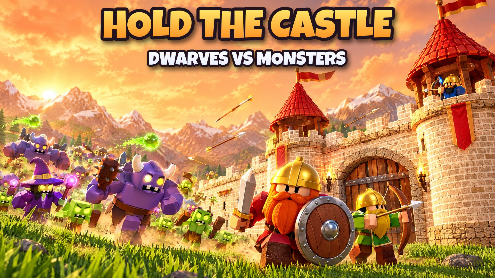

# Hold the Castle (ra7): how to run and play it

Status: **built (every phase of the [master plan](MASTER_PLAN.md)'s build order up to "Test and Launch"; see
[PLAN.md](PLAN.md)), not yet published.** Publishing needs a Roblox experience for it (see [Publish](#publish)).



Everyone starts as a dwarf. You have a few minutes to dig stone, wood and gold and build a castle around the
shrine together. Then the plague comes: about one dwarf in four turns into a monster, and the monster army
attacks. Three shrines stand in a row; a shrine drains while monsters near it outnumber the dwarves, and when one
falls the dwarves fall back to the next. Dwarves win if a shrine still stands when the clock runs out. Monsters
win by taking the last shrine or beating every dwarf. A dwarf who falls in the fight comes back as a monster.

## Run it in Roblox Studio

1. Install [Rokit](https://github.com/rojo-rbx/rokit), then in `games/ra7 - Hold the Castle/` run `rokit install`.
2. Open `HoldTheCastle.rbxl` in Studio and press Play. Or rebuild it with `rojo build -o HoldTheCastle.rbxl`, or
   run `rojo serve` and connect the plugin.
3. One player is enough: the first player into an empty server starts a match after 4 seconds, NPC dwarves help
   you build, and the NPC horde attacks (nobody turns with fewer than 4 players). Use **Test > Clients and
   Servers** with 4 players to see the plague turn someone.
4. Without API access in Game Settings the game runs but doesn't save, the best-hold board shows this server
   only, and friend teleports say they can't reach the match (teleports don't work in Studio).

## How to play

| Do | Phone | Keyboard + mouse | Gamepad |
|---|---|---|---|
| Mine, build, fix, or attack (it picks the right one) | the big **MAIN** button | click or F | R2 |
| Your job's special move | **SPECIAL** (its cooldown sweeps round it) | Q | L2 |
| Build mode (dwarves) | **🏗️ BUILD** | B | Y |
| Turn / place a piece | **🔄 TURN** / **✅ PLACE** | R / click | X / A |
| Pick a dwarf job | the Job Board's prompt | E at the board | X |
| Pick a monster job | **🔄 JOB** at the monster spawn | J | the JOB button |
| Ping your team | **📢** | G | DPad up |
| Eat / drink a potion | 🍲 / 🧪 | Z / C | the buttons |
| Emote | **⚙️ MORE** → Emotes | H | MORE |
| Shop, tasks, friends, settings | the menu at the top right | same | same |

### One match

1. **The hangout.** Between matches you wait on a deck high on the ridge with the looks shop, the podium for the
   last match's best and the **longest hold** board.
2. **Build time** (6 minutes with 1-4 players, 7 with 5-8, 8 with 9 or more). You spawn in the camp at the Hill
   Shrine. The guide walks you through it in short steps: tap the glowing rocks, bring the stone to a glowing
   blueprint and hammer it, pick the castle's first upgrade (a stronger gate, a tower or a thicker wall), pick a
   job at the Job Board. At 2:00 the sky dims, a horn blows and monsters gather on the far hill; from about 2:50
   scouts come over to test your walls.
3. **The plague** (8 seconds). The sky turns purple-green and about 1 in 4 dwarves turn into monsters (volunteers
   first; players with friends in the server last, so groups stay together).
4. **The attack** (12 minutes on the clock). Waves of NPC monsters and the monster players march on the active
   shrine. Monsters get stronger as they level up in the match and as the fight goes on. Dwarves who fall come
   back as monsters 5 seconds later.
5. **Taking a shrine.** Inside a shrine's ring (26 studs), if monsters outnumber dwarves, it drains: 0.8% a second
   for each extra monster, at most 4% a second, less with Shrine Wards and a grander castle. With no monster near
   it heals. At 75%, 50% and 25% everyone is warned. When it falls, the magic wall to the next zone opens, dwarves
   get a burst of speed to fall back, and monsters spawn at the fallen shrine a few seconds later.
6. **The last stand.** The Cave Shrine: red night light, faster music.
7. **The end.** Who won, how long the dwarves held, coins and XP, the match's best builder, defender, monster,
   healer and last dwarf standing. After 12 seconds everyone goes up to the hangout, and the next match starts
   18 seconds after that.

### The map

The **Hill Shrine** on a hill plateau (four ramps, a creek, the camp), the **Canyon Shrine** in a canyon with a
rock spine down the middle, and the **Cave Shrine** inside the mountain (a main tunnel and a side tunnel). The
monsters' rift is in the forest to the west. Gold veins sit in two mines in the valley walls.

### Jobs (5 a side, each good at one thing)

| Dwarf | Main | Special | Trait |
|---|---|---|---|
| 🔨 Builder | Hammer | ⚡ Quick Wall: a free wall in front of you | Builds and fixes twice as fast |
| ⛏️ Miner | Pickaxe | 💥 Big Dig: a big chunk out of a rock, tree or vein | Mines twice as much, carries more, finds gems |
| 🛡️ Fighter | Big Swing | 🛡️ Shield Wall: block most damage, push monsters back | Lots of health |
| 🏹 Archer | Shoot | 🎯 Volley: five arrows at once | Hits harder and farther from up high |
| 💚 Healer | Mend | ✨ Ward: heal everyone near you, shield the walls | Dwarves near you build a quarter faster |

| Monster | Main | Special | Trait |
|---|---|---|---|
| 👺 Grunt | Claw | 📣 Roar: monsters near you get fast and fierce | Hits harder with friends around |
| 🦍 Brute (monster level 2) | Pound | 💨 Charge: run through everything in front of you | Takes lots of hits |
| 🦎 Spitter | Spit | 🟢 Goo Puddle: dwarves in it slow down and get hurt | Hits from far away |
| 🧙 Witch (monster level 2) | Hex | 🌀 Dark Circle: heal monsters near you, call two imps | Floats; hexed walls take more damage |
| 🪓 Breaker | Ram | 💣 Bomb: blows up walls | Slow, easy to beat up close |

Every monster job opens to everyone after 4 minutes of fighting. Monsters swap jobs at their spawn.

### Building

Mine with MAIN next to a rock pile (stone), a tree (wood) or a vein (gold): 24 slots in your bag (36 for Miners).
In build mode a ghost shows where the piece goes: green where it can, red (and why) where it can't. A placed
piece is a glowing blueprint everyone can help with: each hammer hit puts 2 materials in (3 for Builders) and
does work, and the piece rises out of the ground until it's done. Dwarves never damage their own castle.

16 pieces: stone wall, wood wall, gate (dwarves walk through, monsters don't), archer tower, quick wall, stairs,
spike trap, pit trap, oil pot, fix-it station, healing station, forge (armor and weapons for this match), kitchen
(food), potion table (a quick heal and a burst of speed), banner and Shrine Ward (two per shrine). Walls, gates
and towers can be upgraded (Thicker Wall, Stone Facing, Iron Gate, Grand Tower). The castle grows from **Camp**
to **Town** to **Castle** as the pieces around a shrine add up; a grander castle drains slower.

### Between matches

Coins and XP for playing (more for holding on, building, beating monsters and winning), account and job levels,
a **looks shop** (dwarf armor, beards, monster skins, weapon looks, build effects, emotes, win poses, castle flags,
each with a turning 3D preview), **titles** earned from your stats (Wall Master, Monster Hunter, Last Dwarf
Standing...), a **daily gift** with a 7-day streak, **three daily tasks** and a **weekly** one. Looks only:
nothing you can buy or earn makes anyone stronger.

### Friends

**👋 FRIENDS** lists your friends in this game and how their match is going; **JOIN** takes you to their exact
server. **Server full** offers *Wait for a spot* (we try again every 15 s, up to 8 times: an honest retry, not a
queue), *Join another friend*, or *Start a private match* (friends can still join it from their panel). Dropped
out? If your match is still going you're offered to go back.

## How it's built

```text
games/ra7 - Hold the Castle/
  src/shared/   Constants (every tunable), Net (rate-limited remotes), Formulas (all game math),
                Data/ (Jobs, Pieces, Looks, Tasks), World/ (MapLayout, Kit, PieceModels, Costumes, LightingPresets)
  src/server/   World/ (TerrainBuilder: the land as smooth terrain; MapBuilder: everything on it; Groups)
                Services/ MatchService (the phases), TeamService, ResourceService, BuildService, HordeService,
                ShrineService, CombatService, CraftService, ProgressService, PingService, TutorialService,
                JoinService, AnalyticsService, GameLogService, FeedbackService, AntiCheatService, PlayerDataService
  src/client/   Controllers/ Hud, Input, Build, Horde, Anim, Fx, Panel, Tutorial, Audio, Analytics, Notify,
                Performance; UI/ (Theme, Bus); Store
  tests/        Formulas, Terrain, ClientSmoke, ServerSmoke (whole matches, with and without DataStores)
  tools/        run_tests.sh, luaurun (a small Luau runner), gameplay/ (thumbs.luau, render.js, terrain.js,
                fetch_textures.py, thumbs_post.py, title_art.py)
```

- **The land is Roblox smooth terrain**, written at start-up with `WriteVoxels` (about 2.7 million 4-stud
  voxels; a couple of seconds) from one height function: rolling valley grass and leafy grass with dirt trails worn
  along the monster lanes, a creek of wading-deep water with mud and sand banks, the Hill Shrine's flat top with a
  cobbled plaza and roads, rock cliffs and four cobbled ramps, grassy ridges with rock faces and snowy mountains
  behind, banded sandstone canyon walls round a sandy floor and the rock spine, and the mountain massif with the
  cave and both tunnels hollowed out. Roblox's grass decoration is on, the materials are tinted to the game's
  palette, and the clouds follow the match (white in build time, purple in the plague, red in the last stand).
  NPCs walk on `MapLayout.groundY`, the same heights, and terrain steeper than 50° can't be walked up, so the
  ramps, ridges and canyon walls still guide the fight.
- **Textured materials everywhere** (Roblox's 2022 PBR set, switched on in the project): brick castle walls with
  arrow slits and slate ledges, cobblestone plinths and gate arches, clay-tile cone roofs, wood-plank doors and
  decks, marble shrines, leafy trees and bushes, slate and rock boulders, fabric tents and beards, metal armour.
  On top: a farm, ruins, lanterns, signposts, cacti and bones in the canyon, a natural stone arch, crystals,
  stalactites and stalagmites in the cave.

- **The server decides everything:** the phase and clocks, who's on which team, every hit (with a short wind-up),
  every piece and every shrine. Clients only draw it and send requests, each rate-limited.
- **The horde is data, not physics:** up to 28 NPCs move on the server 10 times a second along the lanes and
  send a 12-byte-per-NPC snapshot 8 times a second over an unreliable remote; each client draws them a fifth of a
  second in the past, interpolated, and animates them by hand (walks, swings, flinches, carried rocks, tumbles).
- **Animation is a core feature** (§13): moves have a visible wind-up and strike; carrying, being tired, flinching,
  emotes and the winners' cheer are all drawn on top of Roblox's walk on each client.
- **Phone first:** a 1000 × 560 layout scaled to the screen, the big buttons on the right, nothing in the thumb
  corners, a lite mode on phones (less decoration, fewer particles, shorter NPC draw distance), Reduced Motion,
  transparency and text size respected.

## Tests

```bash
cd "games/ra7 - Hold the Castle"
sh tools/run_tests.sh   # formulas (95), terrain (52), client smoke (232), server smoke (290, 291 without DataStores)
```

The server smoke test plays whole matches on the mock engine: build time with mining, blueprints, NPC dwarves,
the first choice, jobs, crafting, the scare and a scout; the plague with a volunteer; every move and special of
all 10 jobs; shrines falling, barriers opening, the last stand; a dwarf win with rewards, titles, tasks and the
podium; the next match; a monster win by wipe; plus the shop, gifts, pings, friends, private matches, feedback,
analytics, the game log and the anti-cheat. The client smoke test feeds the real client every server event and
presses every button. The terrain test checks the land against the game's heights (the hill top, the ramps,
the valley floor, the canyon and cave floors, the creek, the hangout's plateau), that the cave and tunnels are
open with rock above, that every resource node and spawn is on reachable ground, and the materials, water and
clouds. Lint: selene and stylua clean.

## Analytics and the game log

Same Supabase pipeline as the other games, tagged `game = 'ra7'`: sessions, every request and prompt, the
first-5-minutes funnel (first rock, first build, first wall, first choice, first fight), match start and end,
turned, died, shrines falling, feedback, and a live row per player (team, job, phase, shrine, built, beaten,
health, idle). Open [`other/live.html?game=ra7`](../live.html) and pick **🏰 Hold the Castle** at the top. The
Discord game log gets joins, leaves with session stats, finished matches, anti-cheat flags and errors. Both need
the experience's **`discord_log`** secret (Creator Dashboard → the experience → Secrets), the same key as ra2.

## Publish

1. **Create the experience.** In Studio, open `HoldTheCastle.rbxl` → **File → Publish to Roblox As… → Create new
   experience**, name **Hold the Castle**.
2. **Game Settings:** Places → **Max Players 24**; Security → **Allow HTTP Requests** on and **Enable Studio
   Access to API Services** on; Avatar → R15. Check Lighting → Technology is **Future**.
3. **Secrets:** add `discord_log` (the same value as ra2's) so analytics and the Discord log work.
4. **Icon and thumbnails:** upload `icon/icon_dwarf_gate.png` and the images in
   [`thumbnails/`](thumbnails/README.md). The plan (§25) says to test the building, attack and last-stand
   versions against each other and keep the one with the most clicks that also keeps players.
5. **Later builds:** add the new universe and place to the Open Cloud API key and publish with
   `curl -X POST -H "x-api-key: $ROBLOX_API_KEY" -H "Content-Type: application/octet-stream" --data-binary
   @HoldTheCastle.rbxl "https://apis.roblox.com/universes/v1/{universeId}/places/{placeId}/versions?versionType=Published"`.
6. **Sounds:** the effects and music reuse the studio's uploaded sounds and Roblox library tracks (ids in
   `Constants.SOUNDS` and `Constants.MUSIC`); castle-specific recordings can replace them later by id.
