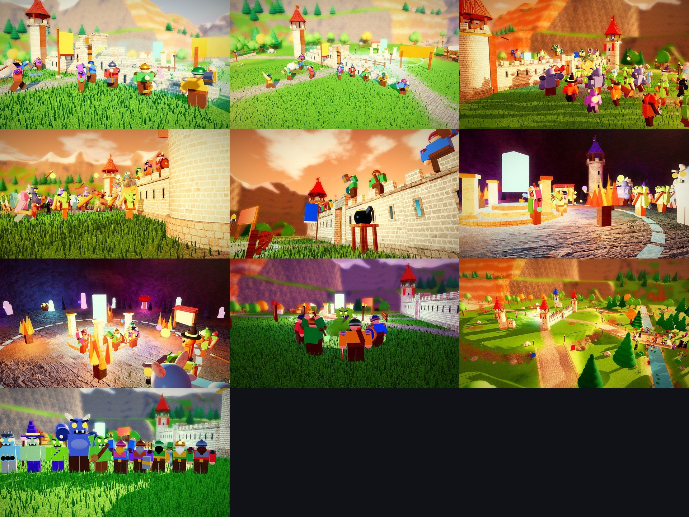

# Hold the Castle: gameplay renders



These are **renders of the game's own models**, not AI: the real map (the smooth terrain `TerrainBuilder`
writes, and everything `MapBuilder` puts on it), castle pieces (`PieceModels`), dwarf and monster costumes
(`Costumes`) and effect shapes, posed into a few moments by `games/ra7 - Hold the Castle/tools/gameplay/thumbs.luau`,
drawn with three.js (`render.js` + `terrain.js`), then the shader pass (`thumbs_post.py`: levels, colour grade,
bloom, depth of field, vignette). They are the references the [thumbnails](../thumbnails/README.md) were made from.

The renderer stands in for Roblox's: the terrain's voxels are meshed and textured per material (blended where
materials meet, with grass blades where Roblox draws its grass decoration and a water surface on the creek), and
parts get textures for their Roblox material. The textures are free CC0 sets from ambientCG picked to look like
Roblox's own (`fetch_textures.py`); the game itself uses Roblox's built-in materials.

| File | Moment |
|---|---|
| `01_building.jpg` | Build time: dwarves hammering the west wall as it rises out of its blueprints |
| `02_building_wide.jpg` | The same, wider: the gate, the rising walls, stone being hauled up the road |
| `03_attack.jpg` | The attack at sunset: the army at the gate, archers on the walls and towers, a bomb at the wall |
| `04_wall_siege.jpg` | Along the outside of the wall: monsters hammering it, arrows and goo flying |
| `05_archers.jpg` | From the courtyard: archers on the battlements against the sunset |
| `06_last_stand.jpg` | The last stand in the Cave Shrine: the last dwarves, the horde, torches |
| `07_last_stand_horde.jpg` | The last stand from the horde's side: the ring of dwarves round the shrine |
| `08_plague.jpg` | The plague: a dwarf turned into a Grunt in a green cloud, the others backing away |
| `09_valley.jpg` | The valley at sunset: the castle on its hill, the army crossing the creek |
| `10_jobs.jpg` | The ten jobs face to face: Builder, Miner, Fighter, Archer, Healer vs Grunt, Brute, Spitter, Witch, Breaker |

Re-render them from the game folder:

```bash
python3 tools/gameplay/fetch_textures.py textures        # once: the PBR texture sets (90 files, about 7 MB)
luaurun tools/gameplay/thumbs.luau out
node tools/gameplay/render.js out renders --modules <node_modules with puppeteer, three, @fontsource> --textures textures
cp out/*.json renders/   # (the shader pass reads each shot's camera from its snapshot)
python3 tools/gameplay/thumbs_post.py renders post --font <LuckiestGuy.ttf>
```

`post/<name>_notext.jpg` are the images here; `post/<name>.jpg` have the title and a caption.
