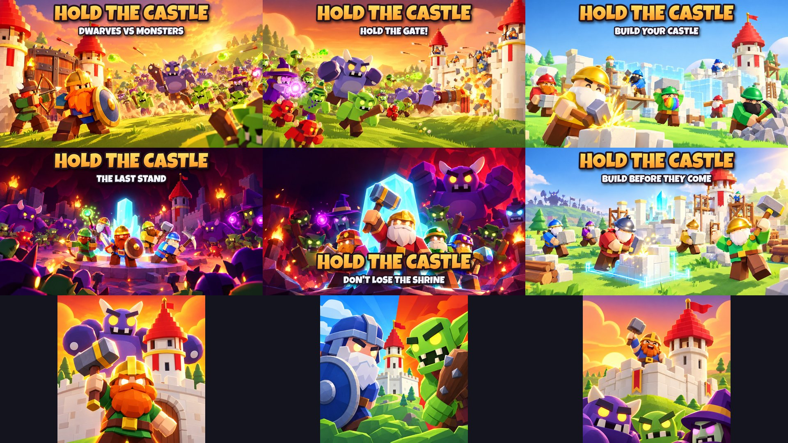

# Hold the Castle: thumbnails and the icon

Every thumbnail is **1920 × 1080 (16:9), JPG, under 0.6 MB**, for experience thumbnails and the Ads Manager. The
icon is `../icon/icon_dwarf_gate.png`, **512 × 512 PNG**; `icon_face_off_alt.png` and `icon_castle_alt.png` are
alternates for an icon A/B test.

**They show what is in the game.** Each one was made with AI image generation (Higgsfield, GPT Image 2.5) from
**real renders of the game** as references (the renders are in [`../screenshots/`](../screenshots/README.md)), so
they keep the game's look: the blocky dwarves with big beards and round shiny helmets, the purple horned Brutes,
green Grunts, Witches in tall purple hats, Breakers with their logs and little red imps, the white castle with
round towers and stepped red roofs, the glowing blue blueprints, the cyan shrine crystal and the red cave. A few
small details are artistic: the wooden scaffolding and the log piles in the building pictures aren't pieces you
can build. The title and captions were added afterwards (`tools/gameplay/title_art.py`) in the game's own
lettering (Luckiest Guy, like the HUD).

The master plan (§25) asks for three versions, one about building, one about the attack and one about the last
stand, shown side by side so we can keep the one with the most clicks that also keeps players. There are two of
each:

| # | File | Version | Scene | Text |
|---|---|---|---|---|
| 1 | `01_dwarves_at_the_gate.jpg` | attack | A fighter with a shield and an archer at the gate, the army charging up the hill at sunset | HOLD THE CASTLE · DWARVES VS MONSTERS |
| 2 | `02_hold_the_gate.jpg` | attack | The monster army storming the wall, a Breaker's log at the gate, archers on the towers, a bomb going off | HOLD THE CASTLE · HOLD THE GATE! |
| 3 | `03_build_your_castle.jpg` | building | Dwarves hammering walls that rise out of their blue blueprints, a rainbow beard, a finished tower | HOLD THE CASTLE · BUILD YOUR CASTLE |
| 4 | `04_the_last_stand.jpg` | last stand | The last five dwarves in a ring round the Cave Shrine's crystal, the horde all around | HOLD THE CASTLE · THE LAST STAND |
| 5 | `05_dont_lose_the_shrine.jpg` | last stand | Close up: a dwarf with his hammer raised before the crystal, a Brute looming behind | HOLD THE CASTLE · DON'T LOSE THE SHRINE |
| 6 | `06_build_before_they_come.jpg` | building | Dwarves building round the shrine, the monster army's silhouettes watching from the hill | HOLD THE CASTLE · BUILD BEFORE THEY COME |

## Checklist (Roblox thumbnail and ad rules, master plan §25)

- [x] **Matches the game.** The real characters, jobs, castle pieces, shrines and places.
- [x] **No promises.** No "FREE", "NEW", "UPDATE", rewards or prizes.
- [x] **No fake interface.** No fake buttons, menus or prompts.
- [x] **Kid-friendly action.** Cartoon fighting with no blood or gore; monsters are goofy, not scary.
- [x] **Big and bright.** The heroes are large in the frame, the title is big; it reads on a phone.
- [x] **Size.** 16:9, 1920 × 1080, under 0.6 MB. Icon 512 × 512.
