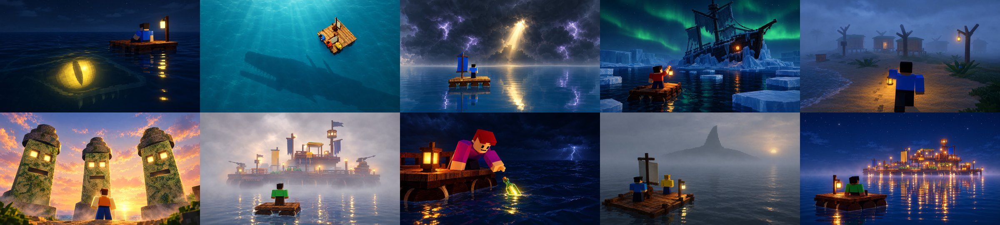

# Build the Biggest Raft: ad images

These are the pictures for **Roblox Ads Manager** (sponsored experience ads). The pictures for the game's own page
are in [`../thumbnails/`](../thumbnails/README.md).

Every image is **1920 × 1080 (16:9), JPG, under 0.5 MB**. A campaign takes up to 10 of them and shows them on the
Home page at 16:9, spread evenly across players. All 10 are here. (The same campaign also runs in search, but
search uses the game's own square picture from its page, not these.)

**The idea: ominous, curious, no text.** An ad has a second to make someone stop scrolling. Each picture is one
small survivor and one thing that's wrong or doesn't add up: an eye in the water, a shadow under the raft, a ship in
the ice. It asks a question without words and leaves the answer for the game. Roblox prints the game's name and
"Sponsored" beside every ad, so the pictures have no title and no words at all. They are dark and quiet on
purpose, so they stand out in a feed full of bright thumbnails.

**They show what is in the game.** Each one was made with AI image generation (Higgsfield, GPT Image 2.5, high
quality, 2k) with **real renders of the game** as references (in [`../screenshots/`](../screenshots/README.md)): the
plank-tile rafts on their log floats, the blocky survivors, the lantern posts, the Leviathan's long-jawed rig, Mist
Hollow's huts, the Ruin's totems, the ship frozen into the Frost Shelf, and a fortress raft built from the game's own
pieces. In the game the survivors are the players' own avatars.

| # | File | Picture | In the game |
|---|---|---|---|
| 1 | `01_eye_in_the_water.jpg` | Night. A survivor sits on a tiny raft by a lantern; under the black water beside them, a huge glowing eye and the outline of a jaw | The Leviathan, at the Trench at night |
| 2 | `02_shadow_under_the_raft.jpg` | From high above: a small raft on clear teal water, sun rays going down, and a giant long-jawed shadow sliding underneath | The Leviathan |
| 3 | `03_storm_wall.jpg` | A lone survivor on a raft with a blue sail, facing a black wall of storm and purple lightning, one beam of gold light breaking through | Storms: they darken the sky and bring rain and lightning |
| 4 | `04_frozen_ship_lights.jpg` | Night, green northern lights. A survivor with a lantern rafts between ice floes toward an old ship frozen into the ice, one window lit | The Frost Shelf's frozen ship |
| 5 | `05_fog_village.jpg` | A foggy beach at dusk: a survivor with a lantern walks toward empty huts on stilts, one window lit, footprints in the sand | Mist Hollow ("Fog, old huts, something in the reeds") |
| 6 | `06_watching_totems.jpg` | Sunset, looking up: three mossy stone totems with glowing eyes tower over a survivor | The Ruin's totems |
| 7 | `07_fortress_in_the_fog.jpg` | A survivor on a 2 × 2 starter raft in the fog, facing a huge two-deck fortress raft with lanterns, turrets and flags | Other players' rafts (VISIT), and what yours can become |
| 8 | `08_bottle_in_the_storm.jpg` | A stormy night, lightning far off: a survivor leans off the raft for a glowing green bottle | Bottles drift in with charts to new places |
| 9 | `09_fin_in_the_fog.jpg` | Two survivors on a small sailing raft in grey fog; far ahead, a dark shape like a giant fin, or a rock | Fog on a voyage, islands rising out of it, sharks circling rafts |
| 10 | `10_lights_on_the_horizon.jpg` | Night: a survivor on a tiny raft with a lantern looks at a raft city glowing on the horizon | Other players' rafts, lit by their lanterns |

Some details are made up for the picture: the Leviathan's eye glows, and its shadow is bigger than it looks from a
raft; the totems' eyes glow; the northern lights and the lit windows (the frozen ship, the hut) aren't in the game;
the shape in number 9 is left unclear on purpose. Everything else (the places, the creatures, the pieces) is there.

Roblox's thumbnail guide asks for pictures that don't make the graphics look better than what a player will see.
These are lit and finished more richly than the game itself. Ads go through moderation, so if one is rejected for
that, use the renders in [`../screenshots/`](../screenshots/README.md) (the game's own models) as the safer set.

Start with 1, 2, 4 and 7: they show the ocean, a raft and the biggest mysteries.

## Checklist (Roblox ad rules)

- [x] **Matches the game.** Every place, creature and piece is in the game (see the table).
- [x] **No text, no promises.** No words at all, so no "FREE", rewards or prizes.
- [x] **No fake interface.** No buttons, menus or prompts.
- [x] **Kid-friendly.** Ominous, not gory: no blood, no wounds, no jump-scare faces. The survivors are calm and
  curious, never hurt.
- [x] **One clear subject.** One survivor or two and one strange thing, readable on a phone.
- [x] **Size.** 16:9, 1920 × 1080, under 0.5 MB.

## Run them

Set the icon and the store thumbnails first ([how](../thumbnails/README.md#upload-them)): search shows the game's own
square picture.

1. **Ads Manager** (create.roblox.com/advertise) → **Manage Ads** → **Create Campaign**.
2. **Experience**: Build the Biggest Raft. **Goal**: Plays. **Audience**: New Players (or All Players).
3. **Budget & Duration**: a daily or a lifetime budget, the start date and how long it runs.
4. **Creatives**: upload the pictures from this folder, up to 10 (or the four above to start).
5. **Publish**. Ads are moderated, usually within 24 hours, and go live once approved.
6. After a few days, compare the pictures' results. Pause the weakest and keep the ones whose players stay.

## Making them again

1. Render the references: see [`../screenshots/README.md`](../screenshots/README.md) (the mystery scenes are
   `11` to `16`; the Leviathan is `07`, a storm `06`, a raft `03`).
2. Upload the renders to Higgsfield and generate each picture with GPT Image 2.5 (high quality, 2k, 16:9) with
   one or two renders as image references. Each prompt describes the scene, asks for the blocky Roblox style of the
   references, one small survivor and one strange thing, a dark and quiet mood ("ominous and mysterious,
   kid-friendly, no gore"), and **no text, letters or logos**.
3. Size each to 1920 × 1080 and save as JPG (quality about 90) to stay under 0.5 MB.
4. Make the sheet: `python3 tools/gameplay/contact_sheet.py _all.jpg --cols 5 --width 480 <the 10 pictures>`.
