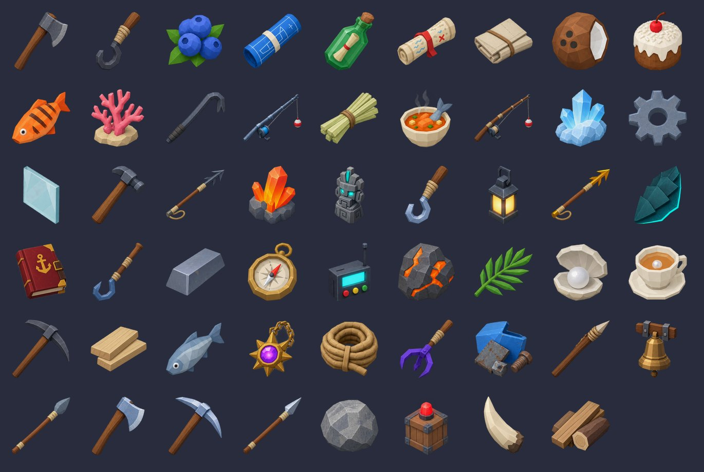

# The Endless Voyage: item icons



2D icons for all 53 items, made with AI image generation (Higgsfield, GPT Image 2.5) from renders of the game's
own item models (`tools/gameplay/items_sheet.luau`), as four 4 × 4 sheets on a transparent background, then cut
into one PNG per item (`tools/icons/slice_sheets.py`), 320 × 320 each.

**The game does not need them to look right.** Every slot, hotbar cell, crafting row and build row shows a little
3D view of the item's own model (`client/UI/Icons` + `World/ItemModels`), so what you hold is what the icon shows.
These are the optional 2D upgrade: once uploaded to Roblox, the UI shows the uploaded picture instead.

## Using them

1. Make an Open Cloud API key at https://create.roblox.com/dashboard/credentials with the **Assets** API system
   (Read and Write) for your user or group, and allow your IP.
2. From the game folder:
   ```bash
   ROBLOX_API_KEY=... python3 tools/icons/upload_icons.py ../../other/ra8/items --user <your user id>
   ```
   (or `--group <group id>`). It uploads each PNG as an Image asset and writes their ids into
   `src/shared/Data/IconIds.lua`; re-running only uploads what is missing. The icons show in the game once Roblox
   has moderated them (usually minutes). Rebuild the place (`rojo build`) and publish.

## Making them again

```bash
tools/luaurun/target/release/luaurun tools/gameplay/items_sheet.luau out     # the reference renders
node tools/gameplay/render.js out renders --modules <node_modules> --textures <pbr dir>
```
Generate each sheet with GPT Image 2.5 (1:1, high, 2k, background transparent) with the renders as image
references and the prompt naming the 16 items of the sheet in order, row by row; save them as `sheet_<n>.png` next
to a `sheet_<n>.txt` listing the 16 keys; then
```bash
python3 tools/icons/slice_sheets.py sheets ../../other/ra8/items --size 320
```
