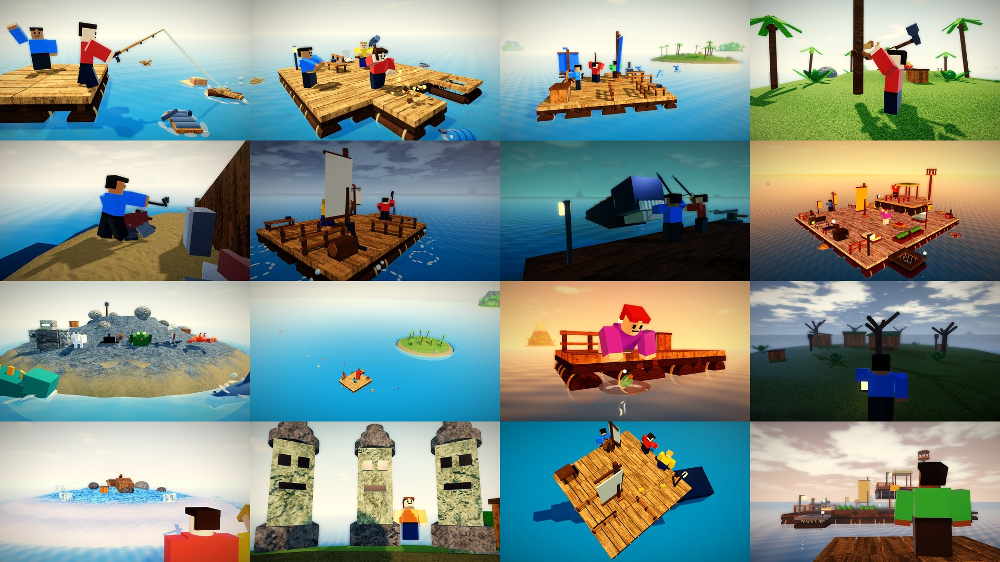

# The Endless Voyage: gameplay renders



These are **renders of the game's own models**, not AI: the ocean and the island terrain (`OceanBuilder` writes
the water, `IslandBuilder` the islands' smooth terrain and their palms, bushes, rocks, ore, wrecks, ruins, huts,
totems and containers), the raft pieces at their real grid positions the way `RaftService` builds them
(`RaftModels`: nets are tiles of their own beside the raft), the debris that drifts past (`OceanModels`), the
creatures' rigs posed the way the client poses them (`Rigs`), the tools and items (`ItemModels`) and the effects'
shapes, staged into a few moments by `games/ra8 - The Endless Voyage/tools/gameplay/thumbs.luau`, drawn with
three.js (`render.js` + `terrain.js`), then the shader pass (`thumbs_post.py`: levels, colour grade, bloom, depth
of field, vignette). The survivors are plain blocky Roblox avatars (in the game they're the players' own avatars).
They are the references the [thumbnails and icon](../thumbnails/README.md) were made from.

The renderer stands in for Roblox's: the terrain's voxels are meshed and textured per material, and parts get
textures for their Roblox material (free CC0 sets from ambientCG picked to look like Roblox's own,
`fetch_textures.py`). The water is a flat plane here, kept half see-through, with a deep-blue floor under it so
the sea bed doesn't show; in Roblox it's terrain water with waves.

| File | Moment |
|---|---|
| `01_first_cast.jpg` | The first minute: two survivors on the 2 x 2 driftwood platform, the rod's line cast out to a plank, debris drifting past |
| `02_build_your_raft.jpg` | A survival raft growing: a tile being hammered down, a net beside the raft, more wood coming aboard |
| `03_set_sail.jpg` | Setting sail: the sail up, a hand at the helm, dolphins alongside, Palm Key ahead |
| `04_palm_key.jpg` | Ashore on Palm Key: chopping a palm, a chest among the bushes, crabs on the beach |
| `05_the_wreck.jpg` | The Drifter: a hull on its side, a crowbar at the salvage, a lurker in the reeds |
| `06_storm.jpg` | A storm at sea: spray over the deck, a cracked tile, the hammer out, a shark at the edge |
| `07_the_leviathan.jpg` | Night at the Trench: the Leviathan rearing up beside a floating fortress, harpoons flying |
| `08_legendary_vessel.jpg` | A legendary vessel at dusk: two decks, gold flags, the aquarium, the trophy stand |
| `09_the_cast.jpg` | Everything that lives out there, on Gull Rock's shore: gulls, crabs, lurkers, a serpent, the Guardian |
| `10_the_ocean.jpg` | The ocean from above: a raft on its plot, its island, debris coming in on the current, the far isles |
| `11_message_in_a_bottle.jpg` | Dusk: a green bottle with a note in it bumping the raft, a survivor reaching down for it |
| `12_mist_hollow.jpg` | Mist Hollow at evening: the huts nobody came back to, the lanterns, a survivor with a lantern |
| `13_frost_shelf.jpg` | The Frost Shelf: the ship frozen into the ice, a raft coming in |
| `14_the_totems.jpg` | The Ruin's three totems, turned inland, staring at whoever comes up from the beach |
| `15_the_shadow.jpg` | At the Trench, something enormous passes under the raft; they look down and see it go by |
| `16_who_built_that.jpg` | In the fog, a starter raft drifts up to a fortress somebody else built, its lamps lit |

Re-render them from the game folder:

```bash
python3 tools/gameplay/fetch_textures.py textures        # once: the PBR texture sets
tools/luaurun/target/release/luaurun tools/gameplay/thumbs.luau out          # [only,...] renders a few
node tools/gameplay/render.js out renders --modules <node_modules with puppeteer, three, @fontsource> --textures textures
cp out/*.json renders/   # (the shader pass reads each shot's camera from its snapshot)
python3 tools/gameplay/thumbs_post.py renders post --font <LuckiestGuy.ttf>
python3 tools/gameplay/contact_sheet.py _all.jpg --cols 4 --width 480 post/*_notext.jpg
```

`post/<name>_notext.jpg` are the images here; `post/<name>.jpg` have the title and a caption. The capture prints
where each shot's survivors and creatures land in the frame and flags anything the edge cuts, so a framing can be
checked before the render (about 20 seconds a shot).
