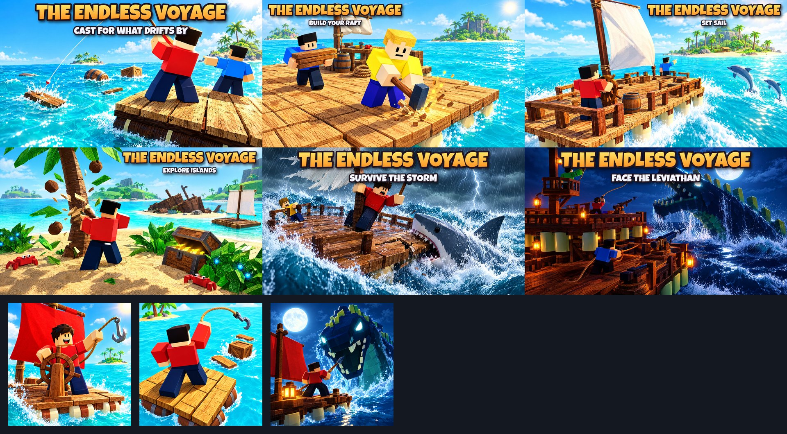

# The Endless Voyage: thumbnails and the icon

Every thumbnail is **1920 × 1080 (16:9), JPG, under 0.6 MB**, for experience thumbnails and the Ads Manager. The
icon is `../icon/icon_helm.png`, **512 × 512 PNG**; `icon_leviathan_alt.png` and `icon_hook_alt.png` are
alternates for an icon A/B test.

**They show what is in the game.** Each one was made with AI image generation (Higgsfield, GPT Image 2.5) from
**real renders of the game** as references (the renders are in [`../screenshots/`](../screenshots/README.md)):
the plank-tile rafts the way `RaftService` builds them (driftwood tiles, railings, barrels, the workbench, the
helm, the sail, the crow's nest, the two-deck fortress with its turrets and lanterns), the debris that drifts
past (planks, barrels, crates), the rod and its line (the hook was replaced by the rod in round 3), the hammer and the axe, the blocky survivors, Palm Key's
palms, bushes and chests, the wreck on its side, the storm, the shark, and the Leviathan's rig (the long jawed
head and the finned back). In the game the survivors are the players' own avatars. A few small details are
artistic: the dolphins jump a little higher than the game's, and the storm's lightning is a bolt rather than
the game's flash. The title and captions were added afterwards (`tools/gameplay/title_art.py`) in the game's own
lettering (Luckiest Guy, like the HUD), kept off the characters.

The master plan (§2, store presentation) asks the store art to say "build a raft, sail, explore, survive": the
first cast, the building, the sail, an island, a danger, and the Leviathan. There's one of each:

| # | File | Shows | Scene | Text |
|---|---|---|---|---|
| 1 | `01_cast_for_what_drifts_by.jpg` | the first minute | Two survivors on the four-tile driftwood platform, a rod's line cast out to the planks and crates drifting past | THE ENDLESS VOYAGE · CAST FOR WHAT DRIFTS BY |
| 2 | `02_build_your_raft.jpg` | building | A survival raft growing: a tile hammered down at the edge, planks hauled, the workbench and mast behind | THE ENDLESS VOYAGE · BUILD YOUR RAFT |
| 3 | `03_set_sail.jpg` | the voyage | The sail full, a hand at the helm, dolphins alongside, a palm island ahead | THE ENDLESS VOYAGE · SET SAIL |
| 4 | `04_explore_islands.jpg` | exploration | Ashore: an axe at a palm, a chest in the bushes, crabs, a wreck on the far shore, the raft at the beach | THE ENDLESS VOYAGE · EXPLORE ISLANDS |
| 5 | `05_survive_the_storm.jpg` | danger | A storm: waves over the deck, a cracked tile, the hammer out, a shark biting the raft's edge | THE ENDLESS VOYAGE · SURVIVE THE STORM |
| 6 | `06_face_the_leviathan.jpg` | the end game | Night: the Leviathan rising beside a floating fortress, harpoons flying from the deck | THE ENDLESS VOYAGE · FACE THE LEVIATHAN |

| Icon | Shows |
|---|---|
| `icon_helm.png` (main) | A survivor at the helm of a small raft under a red sail, a hook in hand (made before round 3 replaced the hook with the rod; the rod's icon alternate is a good next A/B) |
| `icon_leviathan_alt.png` | The Leviathan rising behind a raft, a survivor ready with a harpoon |
| `icon_hook_alt.png` | A survivor on the first raft swinging a hook at the drifting planks (pre-round-3; the game now casts a rod) |

The plan says the raft must be recognisable at a glance and that the art must not copy *Raft*'s branding or
layout: every image is built around the game's own plank-tile rafts and blocky survivors, and none uses another
game's title layout. Test the thumbnails against each other and keep the one with the most clicks that also
keeps players.

## Checklist (Roblox thumbnail and ad rules)

- [x] **Matches the game.** The real rafts, pieces, tools, debris, islands, creatures and the Leviathan.
- [x] **No promises.** No "FREE", "NEW", "UPDATE", rewards or prizes.
- [x] **No fake interface.** No fake buttons, menus or prompts.
- [x] **Kid-friendly.** A cartoon shark and sea serpent, no blood or gore.
- [x] **Big and bright.** The survivors, raft and creatures are large in the frame; the title reads on a phone.
- [x] **Size.** 16:9, 1920 × 1080, under 0.6 MB. Icons 512 × 512.

## Making them again

1. Render the references: see [`../screenshots/README.md`](../screenshots/README.md).
2. Upload the renders to Higgsfield and generate each picture with GPT Image 2.5 (high quality, 2k) with one or two
   renders as image references (the Leviathan render for anything with the Leviathan in it).
3. Letter them: `python3 tools/gameplay/title_art.py art.png out.jpg --font LuckiestGuy.ttf --caption "SET
   SAIL"` (`--left`, `--right` or `--bottom` keep the lettering off the characters).
