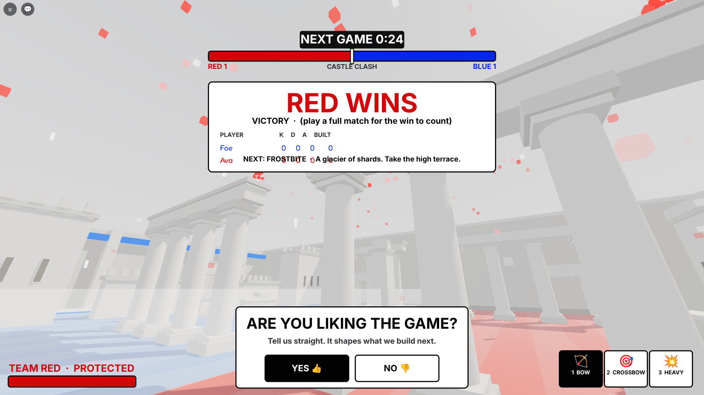
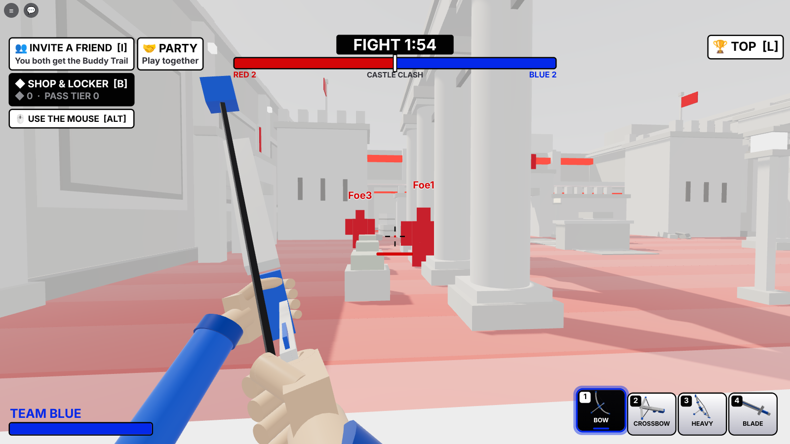
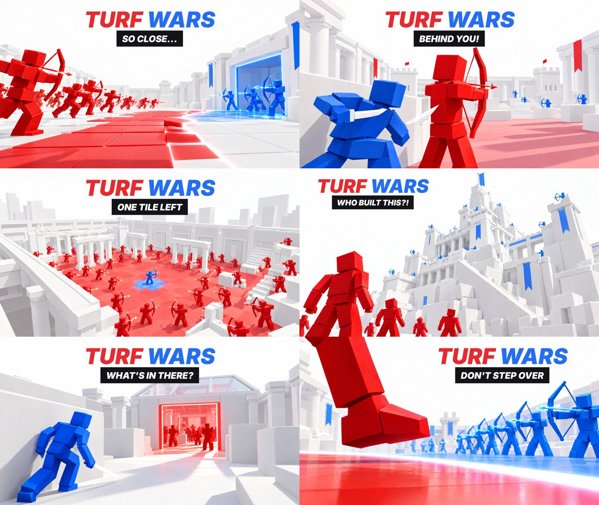
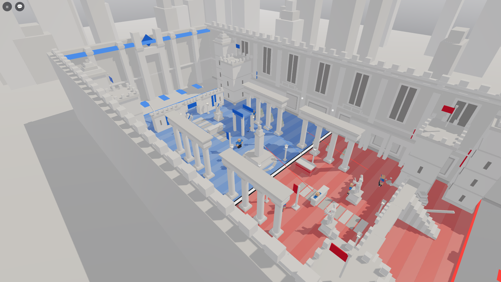
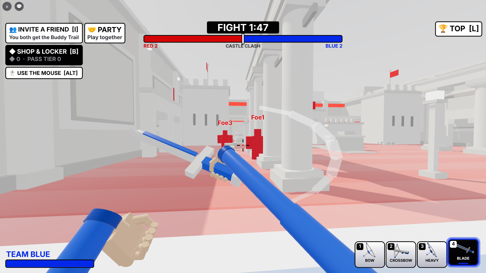

# ra9 · the build plan and what was built

## Round 1 (October 2026): the playable core

Phases A to E of the master plan (§9), tested on the mock engine.

**A. Scaffold.** `games/ra9 - Turf Wars/` from the studio's engine (the service loader, the typed remotes
with per-player rate limits, the session-locked saves, the mock engine and the Luau test runner), the master plan.

**B. The match** (`MatchService`, `TeamService`, `ProgressService`)
* Players join straight into the running match. Teams keep friends together (a party may put its team up to two
  ahead) and balance solo players round them; between matches teams are rebalanced.
* Phases: build 60 s → fight 120 s → build... until a team has no turf; then the results (7 s) and the next map
  in the same server (3 s). A watchdog restarts a match running 45 minutes (logged, never "won").
* The frontline is the server's number. A valid kill (opposing teams, the fight, a real attacker) moves it
  `Formulas.pushCells(players)` cells toward the victim's base: 1 cell in a full server, up to 3 in a small one.
  Falls, resets and friendly fire never move it. A team loses when the line reaches its spawn zone.
* Turf Wars' rule: step onto enemy turf and you're put back on your side.
* Respawn 3 s after going down, 2.5 s of spawn protection.
* Results: everyone's kills, deaths, assists and structures, best first, an MVP (kills ×10, assists ×4, built ×1).
* A qualifying win (on the winning team, in the match 2+ minutes, active) unlocks the next step of the 100-win
  ladder (`Data/Ladder`: arrow trails, bow finishes, kill effects, banners, and a title every 10th win, Recruit to
  Overdrive), streak badges at 3, 5 and 10. All cosmetic.

**C. The maps** (`World/ArenaBuilder`, `World/Maps/*`): one reusable arena (the turf strips, walls with an
invisible shell to a ceiling, a kill plane, spawn zones with ten pads a side) and four layouts in the SUPERHOT
style, mirrored for fairness: Castle Clash (a courtyard: colonnades, gate arches, battlements, a fountain),
Frostbite (a glacier: a high terrace, leaning ice walls, shards, a ridge with three gaps), Jungle Rush (stepped
temples, broken walls, a pillar grove with geometric leaf canopies, a ruined gate), Dust Devil (a canyon of mesas,
two railed bridges, tall angled slabs, an open floor). Each has its own off-white tint and light.

**D. Combat and building** (`CombatService`, `BuildService`)
* Three free bows (`Data/Weapons`): the Standard Bow (a full draw kills), the Rapid Crossbow (34 a bolt, six to a
  magazine, a reload), the Heavy Bow (slow, huge knockback, wrecks structures). None strictly better.
* The server times every draw itself, flies every arrow in 1/30 s steps along the same curve the clients draw,
  against head and body spheres and every solid box (map and structures), and decides hits (heads ×1.35),
  knockback (capped), kills and assists (6 s window). No friendly fire, no damage outside the fight.
* Seven structures on the 4-stud grid (`Data/Structures`), only on your own turf, a cell back from the line, out of
  the spawn zones, within reach; 100 points a player each build phase, a team cap; no wall may close the last
  openings of any row across the field; arrows chip them, the heavy bow breaks them; your own refunded in the build
  phase.

**E. The client**: locked first person (a steady view, a draw zoom, light shakes, sensitivity), the bow in your
hands (string pull, the nocked arrow, the kick), predicted arrows with SUPERHOT tracers in team colours, the build
tray and a snapping preview (white where it can go, red with the reason where it can't), the HUD (phase and clock,
the frontline bar, the objective, the charge, hit markers, the kill feed, health, the bows, build points, results,
unlock cards), sprint, slide, the front flip on every 4th jump, knockback, touch controls (FIRE, RUN, SLIDE, PLACE,
TURN).

**Tests**: 84 unit checks (rules, data, every map built and checked for fairness, closure and open lanes), 66 server
checks (a whole match: teams, building rules, arrows, kills, the line, the turf rule, structures breaking, the
crossbow's magazine, victory, rewards, the next map), 38 client checks (the same through the real client).

## Round 2: the win

* **30 seconds from the win to the next game.** The results card (12 s, compact, under the top bar), then a big
  NEXT GAME IN countdown in the winners' colour; the top pill counts down the whole time.
* **Fireworks** in the winners' colour all over the arena for 14 s: rockets that burst into neon shards (the team's
  colour, a lighter shade, white), drawn on each client from the match's Winner (fewer on phones).
* **Asking the winners** (`FeedbackService`, `FeedbackController`), 6 s after the win so it lands after the
  fireworks start: "Are you liking the game?" YES / NO at most once a day; after a YES, their next win asks for a
  👍 like (once). Roblox doesn't let a game press its like button, so the card asks and its button opens Roblox's own
  favourite prompt. The buttons free the mouse from first person; Y / N answer too.

## Round 3: a thank-you, and nothing on top of anything

* **The Thank-You Trail** (`Data/Extras`): answering "Are you liking the game?" (YES *or* NO: it's the answer that's
  thanked, not liking it, so it stays within Roblox's rules on rewards) gives a trail once, worn straight away: a
  thin white line running beside your arrows' team-coloured tracer, seen by everyone. A THANK YOU card shows it.
  The like / favourite card gives nothing. Kept in the profile (`extras`), equippable again later.
* **Popups have slots** (checked on the smallest canvas, 1240 x 560):
  * unlocks and thank-yous stack down the right under the kill feed, two at a time, the rest waiting their turn
    (they used to sit in the middle, on the results card);
  * the results card shows 5 rows (yours in the last if you're further down) and ends above the question card;
  * no "RED WINS" alert on top of the results card (the card says it);
  * the toast moves up above the build tray's hint in the build phase, and between the results and the question
    card while one is up;
  * the kill feed is 300 wide (it touched the top bar), the objective and alerts narrower;
  * on phones RUN/TURN and SLIDE moved clear of the bows panel and of each other.
* **Words shrink to fit their boxes** inside every card (`Theme.text { fit = n }`), whatever the player's text-size
  setting, and each card's title, words and buttons have their own bands.
* **Tested**: ClientSmoke works out every piece's rectangle and checks that nothing overlaps in the build phase, the
  fight, a win with everything at once (a 12-player table, the question, three unlocks, a toast) and the countdown,
  that nothing sticks out of its card, and that the card words shrink to fit (put back the old feed, buttons and
  table and it fails on each). 84 unit, 83 server, 63 client checks.

## Round 4: invite a friend, both get something

* **INVITE A FRIEND** at the top left (or **I**; on phones a tap): Roblox's invite prompt, with LaunchData
  `i:<your UserId>` ("Come fight with me! We both get the Buddy Trail."). Clickable with the mouse between games.
* **When the friend joins from it** (`InviteService`; a share link counts too, through `ReferredByPlayerId`), the
  friend gets the **Buddy Trail** (two white lines, one each side of the tracer) with an "A FRIEND INVITED YOU!" card,
  and so do you, with "FRIEND JOINED! · Pal came from your invite".
* **Fair:** you must be Roblox friends and not the same account; the friend is credited once ever; you're credited
  once per friend (each new friend still gets you the card and counts in `profile.invite.count`); the trail itself
  is given once.
* **In another server?** The invite usually lands them in yours, but if not, your credit waits in the
  `TWO_InviteCredits_v1` DataStore and you get it the next time you join.
* Tests: 84 unit, 94 server (joining, the cards, rejoining, a stranger, yourself, the inviter elsewhere), 69 client
  (the button, the I key, the trail's lines, the button in the overlap check).

## Round 5: money, cosmetics only

Nothing for sale changes a fight. VIP, MVP and the goals' rewards can't be bought at all: you earn them, so wearing
one says what you did.

**Where cosmetics come from** (`Data/Cosmetics`, ownership in `Data/Locker`):

| Source | How | Examples |
|---|---|---|
| The 100-win ladder | qualifying wins | trails, bow finishes, kill effects, banners, titles |
| **Goals (earned only)** | a stat or a feat (`Data/Achievements`) | Sharpshooter (100 headshot kills), Long Shot (10 kills from 90+ studs), Triple (3 kills in 6 s), Headhunter (5 headshot kills in a match), Comeback Kid (win after being nearly pushed off), Bulldozer, Architect, Unbroken (10 in a row), Marathoner, Centurion |
| **VIP (earned only)** | 50 wins and 10 MVPs, kept for good | a VIP tag over your head, a black halo, the VIP title, Afterimage trail, VIP Shatter effect, Inkwell bow |
| **MVP (earned only)** | each match's MVP wears the **MVP crown** all next match (★ MVP on their tag); 10 lifetime MVPs: the MVP title; 25: the Spotlight kill effect | |
| The shop | Shards (◆), while the item is in the rotation | 22 items across all five kinds |
| The Turf Pass | a season's tiers, free or premium | 13 cosmetics a season, that season's only, never sold again |
| Extras | answering the question, inviting a friend | Thank-You Trail, Buddy Trail |
| Starter Pack | once | the Founder banner |

**Seen in play:** trails on every arrow (lines in white, black or the team's colours, dashed, spinning, glitching,
longer tracers, afterimages), bow finishes on your viewmodel, kill effects where your victims fall (seen by
everyone), the emblem you wear on the team banners you build, your title, VIP and MVP over your head.

**What keeps money coming back (recurring):**

1. **The Turf Pass**, a new season every 4 weeks (R$ 349 each season), 30 tiers from playing; **+1 TIER**
   (R$ 39, buy as often as you like) for the impatient near the season's end.
2. **The rotating shop:** 4 items a day and a 3-item bundle a week at 30% off, the same on every server, each
   gone again soon (FOMO without loot boxes: no paid random items, which also keeps it clear of Roblox's rules and
   countries that ban them).
3. **Shard packs** (developer products, repeatable): 300 / 800 / 1,800 / 4,000 ◆ for R$ 49 / 119 / 249 / 499,
   better value as they grow. Shards are also earned in play (about 30-60 a match, more for the day's first win), so
   free players get there too, and payers are just faster.
4. **Once:** the Starter Pack (R$ 99: 600 ◆ and the Founder banner) for the first purchase.
5. **Optional: the Shard Club**, a Roblox subscription (monthly): 600 ◆ every month. Off until its id is set.

**In game:** ◆ SHOP & LOCKER at the top left (or **B**) opens one panel with four tabs: SHOP (with timers to the
next rotation), PASS (every tier, claim buttons, GET THE PASS, +1 TIER), LOCKER (wear anything you have; what you
don't have says how to get it), GOALS (VIP progress, MVP, every goal with a progress bar). While it's open the mouse
is free, the middle of the HUD steps aside, the question card waits, and toasts show on the panel's own line. The
results card says what the match paid (`+45 ◆ +380 PASS XP`).

**Safety:** Robux receipts are granted exactly once (the receipt ids are kept), and a receipt for someone who
isn't in the server waits for Roblox to retry. The client only asks: the server checks the rotation, the price, the
balance, ownership and the tier.

**To do on Roblox before it can sell anything** (the ids go in `src/shared/Data/Shop.lua`; until then Studio gives
them free so everything can be tried):

* developer products: the 4 Shard packs, the Turf Pass, +1 Tier
* a game pass: the Starter Pack
* optional: a subscription (the Shard Club), then set `Shop.CLUB.subscriptionId`

Tests: 119 unit (every cosmetic has a look, nothing earned-only is for sale, the rotation agrees everywhere, bundle
and pack values, the seasons, goals, VIP, owning), 132 server (earning, buying, refusals, receipts once, the pass and
its claims, the Starter Pack, the club, goals, VIP, the crown, banners), 97 client (the panel's four tabs checked
piece by piece for overlaps, buying and wearing from it, the HUD stepping aside, kill effects, bow finishes).

## Round 6: crouch, phones, the bow in your hands, anti-cheat, store art

* **Crouch:** hold C or Ctrl (or tap CROUCH): lower (the body sinks 1.1 studs, so the hit spheres do too), slower
  (`CROUCH_SPEED`), the bow steadier. Everyone sees it (the server's `MoveService` lowers you too). Crouch while
  sprinting is a slide; still holding crouch at the end of it, you stay down.
* **Phones:** `UI/Device` tells touch, gamepad and keyboard apart at the start and follows live switches (pick up a
  pad, tap a touch laptop), and tells the server. On touch: FIRE, JUMP, CROUCH, RUN, SLIDE and RELOAD round the
  right thumb (ours replace Roblox's own jump button, which sat in the same place), PLACE and TURN while building,
  the bows move to the bottom middle and health to the top left (Roblox's thumbstick has the bottom left), one
  popup at a time. A light aim assist for touch only: a shot let go within 4° of an enemy bends 60% of the way.
  ClientSmoke checks the whole touch layout for overlaps in the fight, the build phase and the win.
* **The bow in your hands** (`WeaponController`): your arms in the team's sleeves come in from the screen's corners
  to hold it; the string is two halves that bend into a V to your hand. Spring motion: up from below on equip, a
  walking bob and breathing, lag behind your view as you look round, dropped across you sprinting, tilted in a
  slide, steadier crouched, toward the middle as you draw (limbs bend, at full draw it shakes, more for the Heavy
  Bow), a snap and kick on release with the string overshooting, the next arrow sliding in, a dip when you land;
  the crossbow lies flat, kicks per bolt and tips down to reload. Everyone else sees a bow in your hand
  (`CombatService:HoldBow`). First-person renders: `screenshots/fp_*.png` (`tools/gameplay/firstperson.luau`).

  

* **Anti-cheat** (`AntiCheatService`): the server already owns every arrow, hit, kill, the line, building and
  money, so it watches the body the client owns and odd patterns: speed and teleports (judged over a second, with
  sprint, slide and our knockback allowed for; pulled back to where the second began), flying (high above ground
  for 3 s), standing inside a built wall, shots refused again and again (too fast, from too far off your head),
  remote spam past the rate limits. Strikes fade; at 6 you're removed with a plain message. Aim outliers (all
  headshots for 25 kills, 92%+ accuracy over 60 shots) are only noted, never struck. Our own teleports and
  knockback set `AcGrace` so they never count. Every flag goes in the profile's `ac` record. ServerSmoke runs the
  whole honest match first and checks nobody was flagged, then a cheater.
* **Store art:** 6 thumbnails ([`thumbnails/`](thumbnails/README.md), titled), 8 ads with no text
  ([`ads/`](ads/README.md)), the icon and two alternates ([`icon/`](icon/README.md)), all from the game's renders.

  

Tests: 119 unit, 146 server, 121 client.

## Round 7: bots when you're alone, the mouse in menus, a numbered hotbar

* **Bots, only for one person on** (`BotService`): alone on a server you get one bot on your team and two against
  you (`BOT_ALLIES`, `BOT_ENEMIES`), named "Ace (bot)" and so on with a 🤖 tag. They are stand-ins the existing
  team, match and combat code treat as players (`MatchService:Everyone()` counts them for spawns, the line and
  turf), so nothing about the rules is special-cased. In the build phase they walk up to their side of the line; in
  the fight they find the nearest enemy they can see, turn, draw and shoot with lead, drop and some spread
  (`BOT_REACT`, `BOT_SPREAD`), and die, push the line and respawn like anyone. They never get results rows, MVP,
  money or anti-cheat strikes, and messages to them are dropped. **The moment a second person joins** the bots go
  and the newcomer takes an enemy bot's place: its team, and (mid-round) the spot where it stood. Back to one
  person, the bots come back; nobody on, none. Touch aim assist sees bots too. `tests/BotSmoke.spec.luau` plays it.
* **The mouse in menus:** the cursor was hidden for good (first person), so the shop opened but nothing in it could
  be clicked. Now `CameraController.mouseFree()` (the panel, a question card, the results) shows the cursor and
  frees it every frame, and hides it again when the menu closes. While it's free the bow doesn't draw or shoot, the
  build tray doesn't place, and the wheel doesn't switch, so a click in the shop is only a click in the shop.
* **Hotbar:** every bow and tray piece has its number in a black badge at its top left (white on the one you're
  holding), the names say only the name. The mouse wheel steps through the bows in the fight and the pieces in the
  build phase (down: the next, round the end).

Tests: 119 unit, 146 server, 140 client, 19 bots.

## Round 8: safe spawns, fairer teams, one bot, a blade, more detailed maps

* **No baseplate:** a place made from Roblox's Baseplate template kept its grey grid plate and SpawnLocation under
  the arena. `ArenaService:ClearTemplate()` removes them (and any template terrain) at start; a wide pale ground now
  lies under everything and a skyline of white monoliths stands in the haze beyond the walls, so nothing outside
  the arena is ever empty.
* **One bot:** alone, you get a single bot against you (`BOT_ALLIES = 0`, `BOT_ENEMIES = 1`); the second person to
  join still takes its place.
* **Teams:** a joining player always goes to the smaller team; with the teams even, to the team losing on turf.
  Only with the turf even too does a friend decide, then a coin flip. (Between matches, teams are still evened.)
* **Spawn rooms:** each base is a walled, roofed room. Its front wall has two doors, and just inside a long baffle
  wall stands between the doors and the pads: you leave round the baffle's ends, along a corridor behind the front
  wall and out of a door. The roof (white frames, glass tinted in the team's colour) stops lobbed arrows. New
  `tests/MapSmoke.spec.luau` checks every map: from anywhere in the field (floor, ledges, tower tops) no straight
  line reaches any pad, and every pad has a clear walk out. Bots follow the same route (`ArenaBuilder.route`).
* **Map detail:** every map's long walls got pilasters with lamps, recessed panels, team banners in each half and a
  cornice; each map got its own extras: Castle Clash flags on the towers, torches at the gate, a cobbled path,
  crates, planters, the fountain's water and lamps; Frostbite icicles, crystal lamps, snow drifts, ice cracks, a
  light pillar; Jungle Rush vines, stepping stones, ferns, shrine lamps, more canopies and rubble; Dust Devil
  geometric cacti, boulders, sandbags, bridge lamps, wind lines in the sand. Every map is now 450+ pieces (still
  within the phone budget).

  

* **The Blade** (slot 4, `🗡️`): click to slash. The server finds the nearest enemy within 7.5 studs and 55° of
  where you look, with nothing solid between: 36 damage (three slashes win), 54 from behind (two win), a shove. A
  half-second cadence, checked on the server. Your viewmodel holds it in the right hand and sweeps it across; others
  see it in your hand. Bots draw it when you're close and switch back to the bow at range.

  

Tests: 121 unit, 158 server, 147 client, 21 bots, 16 maps.

**The name is now just Turf Wars** (was Turf Wars: Overdrive): two plain words, the way the biggest Roblox games are
named. The game's folder is `games/ra9 - Turf Wars/`, the place file `TurfWars.rbxl`, the season pass the Turf Pass,
and the six thumbnails are lettered TURF WARS (`title_art.py` no longer adds OVERDRIVE). The ladder's top title is
still called Overdrive.

**Store page, curiosity pass:** a new description with the hook on its first line ([`DESCRIPTION.md`](DESCRIPTION.md):
"Every hit steals their floor. Don't let them take yours!"), four new icons and six new thumbnails, each stopped on
a moment where something is about to happen (one blue player on the last tile, a blade behind an archer, a red foot
over the line...), with short question lines (SO CLOSE..., BEHIND YOU!, WHAT'S IN THERE?).

## Next (phase F)

* The Discord log and analytics (the studio's shared pipeline), the dashboard entry.
* Lag compensation for hits; bots that also build in the build phase.
* The rest of the cosmetics applied in play (the ladder's trails, bow finishes, kill effects, banners, titles) and a
  locker to pick them.
* The icon and store thumbnails from these renders, the place, publishing.
