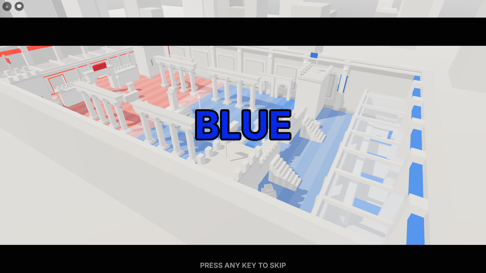
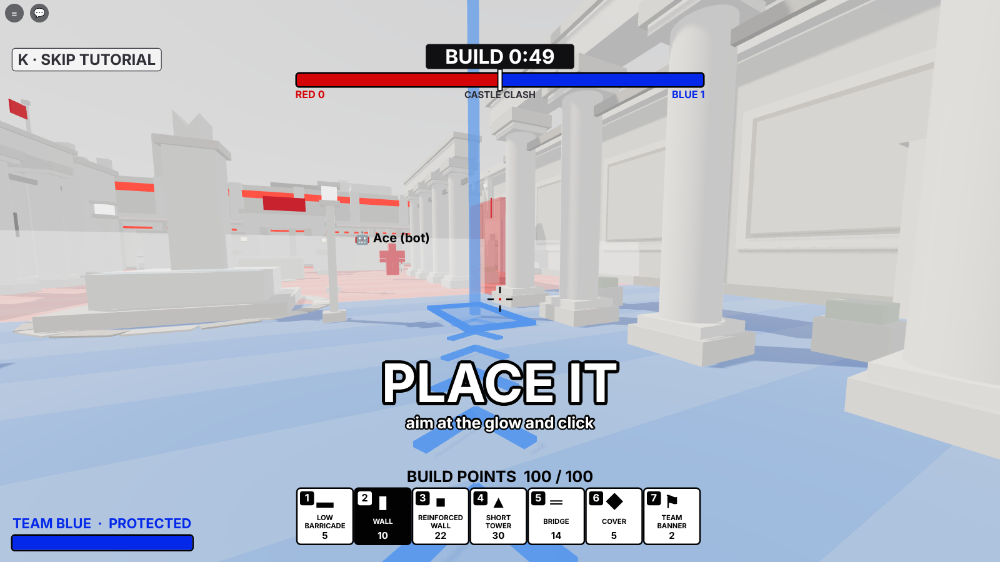
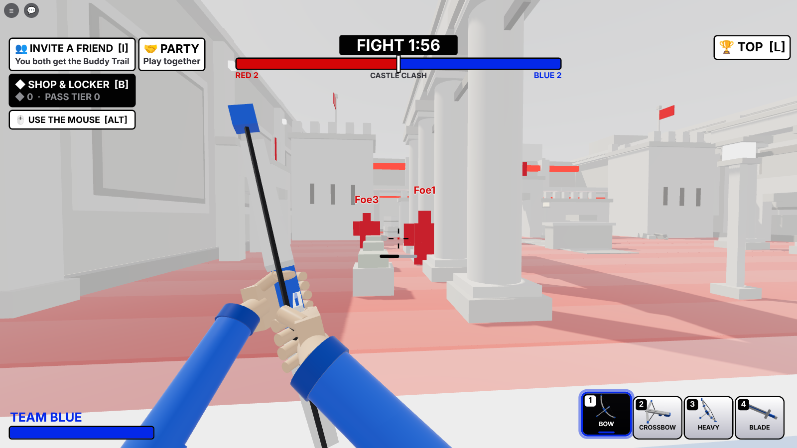
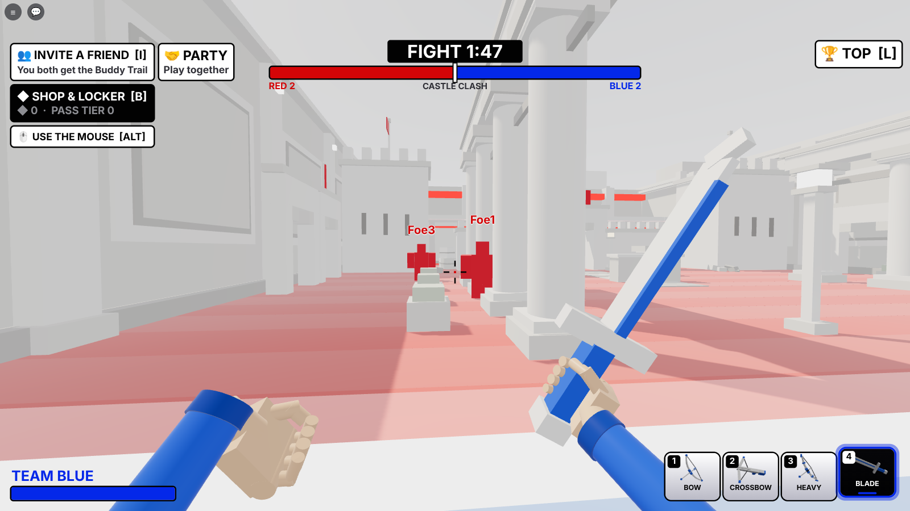
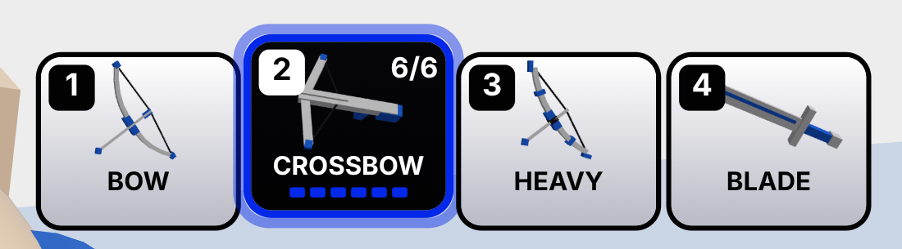
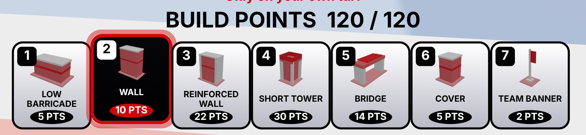
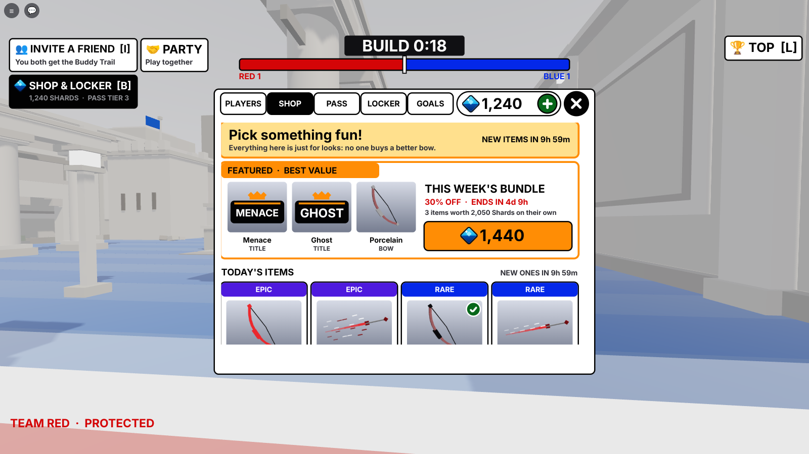
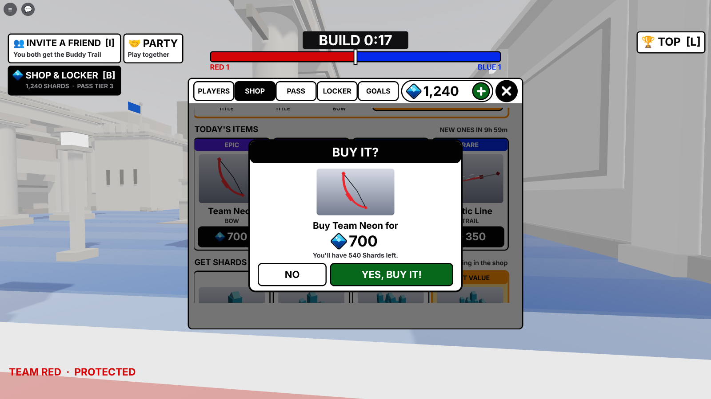
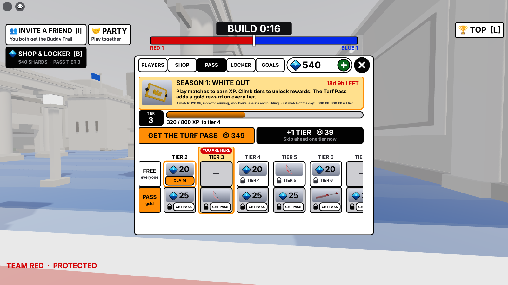
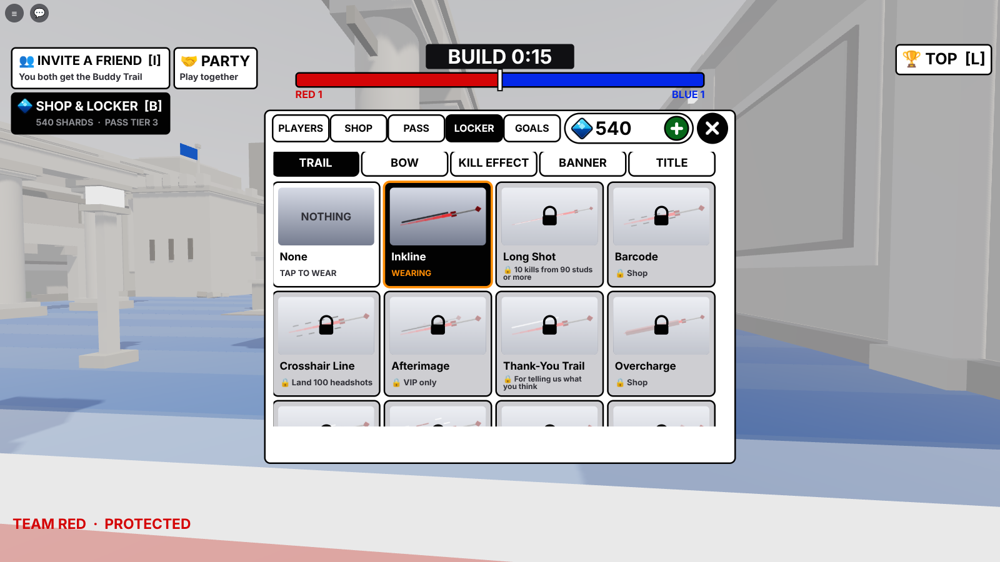

# ra9 · the build plan and what was built

## Round 1 (October 2026): the playable core

Phases A to E of the master plan (§9), tested on the mock engine.

**A. Scaffold.** `games/ra9 - Turf Wars/` from the studio's engine (the service loader, the typed remotes
with per-player rate limits, the session-locked saves, the mock engine and the Luau test runner), the master plan.

**B. The match** (`MatchService`, `TeamService`, `ProgressService`)
* Players join straight into the running match. Teams keep friends together (a party may put its team up to two
  ahead) and balance solo players round them; between matches teams are rebalanced.
* Phases: build 60 s → fight 120 s → build... until a team has no turf; then the results (7 s) and the next map
  in the same server (3 s). A watchdog restarts a match running 45 minutes (logged, never "won").
* The frontline is the server's number. A valid kill (opposing teams, the fight, a real attacker) moves it
  `Formulas.pushCells(players)` cells toward the victim's base: 1 cell in a full server, up to 3 in a small one.
  Falls, resets and friendly fire never move it. A team loses when the line reaches its spawn zone.
* Turf Wars' rule: step onto enemy turf and you're put back on your side.
* Respawn 3 s after going down, 2.5 s of spawn protection.
* Results: everyone's kills, deaths, assists and structures, best first, an MVP (kills ×10, assists ×4, built ×1).
* A qualifying win (on the winning team, in the match 2+ minutes, active) unlocks the next step of the 100-win
  ladder (`Data/Ladder`: arrow trails, bow finishes, kill effects, banners, and a title every 10th win, Recruit to
  Overdrive), streak badges at 3, 5 and 10. All cosmetic.

**C. The maps** (`World/ArenaBuilder`, `World/Maps/*`): one reusable arena (the turf strips, walls with an
invisible shell to a ceiling, a kill plane, spawn zones with ten pads a side) and four layouts in the SUPERHOT
style, mirrored for fairness: Castle Clash (a courtyard: colonnades, gate arches, battlements, a fountain),
Frostbite (a glacier: a high terrace, leaning ice walls, shards, a ridge with three gaps), Jungle Rush (stepped
temples, broken walls, a pillar grove with geometric leaf canopies, a ruined gate), Dust Devil (a canyon of mesas,
two railed bridges, tall angled slabs, an open floor). Each has its own off-white tint and light.

**D. Combat and building** (`CombatService`, `BuildService`)
* Three free bows (`Data/Weapons`): the Standard Bow (a full draw kills), the Rapid Crossbow (34 a bolt, six to a
  magazine, a reload), the Heavy Bow (slow, huge knockback, wrecks structures). None strictly better.
* The server times every draw itself, flies every arrow in 1/30 s steps along the same curve the clients draw,
  against head and body spheres and every solid box (map and structures), and decides hits (heads ×1.35),
  knockback (capped), kills and assists (6 s window). No friendly fire, no damage outside the fight.
* Seven structures on the 4-stud grid (`Data/Structures`), only on your own turf, a cell back from the line, out of
  the spawn zones, within reach; 120 points a player each build phase, a team cap; no wall may close the last
  openings of any row across the field; arrows chip them, the heavy bow breaks them; your own refunded in the build
  phase.

**E. The client**: locked first person (a steady view, a draw zoom, light shakes, sensitivity), the bow in your
hands (string pull, the nocked arrow, the kick), predicted arrows with SUPERHOT tracers in team colours, the build
tray and a snapping preview (white where it can go, red with the reason where it can't), the HUD (phase and clock,
the frontline bar, the objective, the charge, hit markers, the kill feed, health, the bows, build points, results,
unlock cards), sprint, slide, the front flip on every 4th jump, knockback, touch controls (FIRE, RUN, SLIDE, PLACE,
TURN).

**Tests**: 84 unit checks (rules, data, every map built and checked for fairness, closure and open lanes), 66 server
checks (a whole match: teams, building rules, arrows, kills, the line, the turf rule, structures breaking, the
crossbow's magazine, victory, rewards, the next map), 38 client checks (the same through the real client).

## Round 2: the win

* **30 seconds from the win to the next game.** The results card (12 s, compact, under the top bar), then a big
  NEXT GAME IN countdown in the winners' colour; the top pill counts down the whole time.
* **Fireworks** in the winners' colour all over the arena for 14 s: rockets that burst into neon shards (the team's
  colour, a lighter shade, white), drawn on each client from the match's Winner (fewer on phones).
* **Asking the winners** (`FeedbackService`, `FeedbackController`), 6 s after the win so it lands after the
  fireworks start: "Are you liking the game?" YES / NO at most once a day; after a YES, their next win asks for a
  👍 like (once). Roblox doesn't let a game press its like button, so the card asks and its button opens Roblox's own
  favourite prompt. The buttons free the mouse from first person; Y / N answer too.

## Round 3: a thank-you, and nothing on top of anything

* **The Thank-You Trail** (`Data/Extras`): answering "Are you liking the game?" (YES *or* NO: it's the answer that's
  thanked, not liking it, so it stays within Roblox's rules on rewards) gives a trail once, worn straight away: a
  thin white line running beside your arrows' team-coloured tracer, seen by everyone. A THANK YOU card shows it.
  The like / favourite card gives nothing. Kept in the profile (`extras`), equippable again later.
* **Popups have slots** (checked on the smallest canvas, 1240 x 560):
  * unlocks and thank-yous stack down the right under the kill feed, two at a time, the rest waiting their turn
    (they used to sit in the middle, on the results card);
  * the results card shows 5 rows (yours in the last if you're further down) and ends above the question card;
  * no "RED WINS" alert on top of the results card (the card says it);
  * the toast moves up above the build tray's hint in the build phase, and between the results and the question
    card while one is up;
  * the kill feed is 300 wide (it touched the top bar), the objective and alerts narrower;
  * on phones RUN/TURN and SLIDE moved clear of the bows panel and of each other.
* **Words shrink to fit their boxes** inside every card (`Theme.text { fit = n }`), whatever the player's text-size
  setting, and each card's title, words and buttons have their own bands.
* **Tested**: ClientSmoke works out every piece's rectangle and checks that nothing overlaps in the build phase, the
  fight, a win with everything at once (a 12-player table, the question, three unlocks, a toast) and the countdown,
  that nothing sticks out of its card, and that the card words shrink to fit (put back the old feed, buttons and
  table and it fails on each). 84 unit, 83 server, 63 client checks.

## Round 4: invite a friend, both get something

* **INVITE A FRIEND** at the top left (or **I**; on phones a tap): Roblox's invite prompt, with LaunchData
  `i:<your UserId>` ("Come fight with me! We both get the Buddy Trail."). Clickable with the mouse between games.
* **When the friend joins from it** (`InviteService`; a share link counts too, through `ReferredByPlayerId`), the
  friend gets the **Buddy Trail** (two white lines, one each side of the tracer) with an "A FRIEND INVITED YOU!" card,
  and so do you, with "FRIEND JOINED! · Pal came from your invite".
* **Fair:** you must be Roblox friends and not the same account; the friend is credited once ever; you're credited
  once per friend (each new friend still gets you the card and counts in `profile.invite.count`); the trail itself
  is given once.
* **In another server?** The invite usually lands them in yours, but if not, your credit waits in the
  `TWO_InviteCredits_v1` DataStore and you get it the next time you join.
* Tests: 84 unit, 94 server (joining, the cards, rejoining, a stranger, yourself, the inviter elsewhere), 69 client
  (the button, the I key, the trail's lines, the button in the overlap check).

## Round 5: money, cosmetics only

Nothing for sale changes a fight. VIP, MVP and the goals' rewards can't be bought at all: you earn them, so wearing
one says what you did.

**Where cosmetics come from** (`Data/Cosmetics`, ownership in `Data/Locker`):

| Source | How | Examples |
|---|---|---|
| The 100-win ladder | qualifying wins | trails, bow finishes, kill effects, banners, titles |
| **Goals (earned only)** | a stat or a feat (`Data/Achievements`) | Sharpshooter (100 headshot kills), Long Shot (10 kills from 90+ studs), Triple (3 kills in 6 s), Headhunter (5 headshot kills in a match), Comeback Kid (win after being nearly pushed off), Bulldozer, Architect, Unbroken (10 in a row), Marathoner, Centurion |
| **VIP (earned only)** | 50 wins and 10 MVPs, kept for good | a VIP tag over your head, a black halo, the VIP title, Afterimage trail, VIP Shatter effect, Inkwell bow |
| **MVP (earned only)** | each match's MVP wears the **MVP crown** all next match (★ MVP on their tag); 10 lifetime MVPs: the MVP title; 25: the Spotlight kill effect | |
| The shop | Shards (◆), while the item is in the rotation | 22 items across all five kinds |
| The Turf Pass | a season's tiers, free or premium | 13 cosmetics a season, that season's only, never sold again |
| Extras | answering the question, inviting a friend | Thank-You Trail, Buddy Trail |
| Starter Pack | once | the Founder banner |

**Seen in play:** trails on every arrow (lines in white, black or the team's colours, dashed, spinning, glitching,
longer tracers, afterimages), bow finishes on your viewmodel, kill effects where your victims fall (seen by
everyone), the emblem you wear on the team banners you build, your title, VIP and MVP over your head.

**What keeps money coming back (recurring):**

1. **The Turf Pass**, a new season every 4 weeks (R$ 349 each season), 30 tiers from playing; **+1 TIER**
   (R$ 39, buy as often as you like) for the impatient near the season's end.
2. **The rotating shop:** 4 items a day and a 3-item bundle a week at 30% off, the same on every server, each
   gone again soon (FOMO without loot boxes: no paid random items, which also keeps it clear of Roblox's rules and
   countries that ban them).
3. **Shard packs** (developer products, repeatable): 300 / 800 / 1,800 / 4,000 ◆ for R$ 49 / 119 / 249 / 499,
   better value as they grow. Shards are also earned in play (about 30-60 a match, more for the day's first win), so
   free players get there too, and payers are just faster.
4. **Once:** the Starter Pack (R$ 99: 600 ◆ and the Founder banner) for the first purchase.
5. **Optional: the Shard Club**, a Roblox subscription (monthly): 600 ◆ every month. Off until its id is set.

**In game:** ◆ SHOP & LOCKER at the top left (or **B**) opens one panel with four tabs: SHOP (with timers to the
next rotation), PASS (every tier, claim buttons, GET THE PASS, +1 TIER), LOCKER (wear anything you have; what you
don't have says how to get it), GOALS (VIP progress, MVP, every goal with a progress bar). While it's open the mouse
is free, the middle of the HUD steps aside, the question card waits, and toasts show on the panel's own line. The
results card says what the match paid (`+45 ◆ +380 PASS XP`).

**Safety:** Robux receipts are granted exactly once (the receipt ids are kept), and a receipt for someone who
isn't in the server waits for Roblox to retry. The client only asks: the server checks the rotation, the price, the
balance, ownership and the tier.

**To do on Roblox before it can sell anything** (the ids go in `src/shared/Data/Shop.lua`; until then Studio gives
them free so everything can be tried):

* developer products: the 4 Shard packs, the Turf Pass, +1 Tier
* a game pass: the Starter Pack
* optional: a subscription (the Shard Club), then set `Shop.CLUB.subscriptionId`

Tests: 119 unit (every cosmetic has a look, nothing earned-only is for sale, the rotation agrees everywhere, bundle
and pack values, the seasons, goals, VIP, owning), 132 server (earning, buying, refusals, receipts once, the pass and
its claims, the Starter Pack, the club, goals, VIP, the crown, banners), 97 client (the panel's four tabs checked
piece by piece for overlaps, buying and wearing from it, the HUD stepping aside, kill effects, bow finishes).

## Round 6: crouch, phones, the bow in your hands, anti-cheat, store art

* **Crouch:** hold C or Ctrl (or tap CROUCH): lower (the body sinks 1.1 studs, so the hit spheres do too), slower
  (`CROUCH_SPEED`), the bow steadier. Everyone sees it (the server's `MoveService` lowers you too). Crouch while
  sprinting is a slide; still holding crouch at the end of it, you stay down.
* **Phones:** `UI/Device` tells touch, gamepad and keyboard apart at the start and follows live switches (pick up a
  pad, tap a touch laptop), and tells the server. On touch: FIRE, JUMP, CROUCH, RUN, SLIDE and RELOAD round the
  right thumb (ours replace Roblox's own jump button, which sat in the same place), PLACE and TURN while building,
  the bows move to the bottom middle and health to the top left (Roblox's thumbstick has the bottom left), one
  popup at a time. A light aim assist for touch only: a shot let go within 4° of an enemy bends 60% of the way.
  ClientSmoke checks the whole touch layout for overlaps in the fight, the build phase and the win.
* **The bow in your hands** (`WeaponController`): your arms in the team's sleeves come in from the screen's corners
  to hold it; the string is two halves that bend into a V to your hand. Spring motion: up from below on equip, a
  walking bob and breathing, lag behind your view as you look round, dropped across you sprinting, tilted in a
  slide, steadier crouched, toward the middle as you draw (limbs bend, at full draw it shakes, more for the Heavy
  Bow), a snap and kick on release with the string overshooting, the next arrow sliding in, a dip when you land;
  the crossbow lies flat, kicks per bolt and tips down to reload. Everyone else sees a bow in your hand
  (`CombatService:HoldBow`). First-person renders: `screenshots/fp_*.png` (`tools/gameplay/firstperson.luau`).

  

* **Anti-cheat** (`AntiCheatService`): the server already owns every arrow, hit, kill, the line, building and
  money, so it watches the body the client owns and odd patterns: speed and teleports (judged over a second, with
  sprint, slide and our knockback allowed for; pulled back to where the second began), flying (high above ground
  for 3 s), standing inside a built wall, shots refused again and again (too fast, from too far off your head),
  remote spam past the rate limits. Strikes fade; at 6 you're removed with a plain message. Aim outliers (all
  headshots for 25 kills, 92%+ accuracy over 60 shots) are only noted, never struck. Our own teleports and
  knockback set `AcGrace` so they never count. Every flag goes in the profile's `ac` record. ServerSmoke runs the
  whole honest match first and checks nobody was flagged, then a cheater.
* **Store art:** 6 thumbnails ([`thumbnails/`](thumbnails/README.md), titled), 8 ads with no text
  ([`ads/`](ads/README.md)), the icon and two alternates ([`icon/`](icon/README.md)), all from the game's renders.

  

Then 8 new text-free ads (`ads/`: the last blue tile, arrows stuck in the spawn roof, a blade duel over the line, the
war from above...) and new icons (`icon/`: the main is one player split half red, half blue, with a bow and a blade;
five alternates for the icon test).

Tests: 119 unit, 146 server, 121 client.

## Round 7: bots when you're alone, the mouse in menus, a numbered hotbar

* **Bots, only for one person on** (`BotService`): alone on a server you get one bot on your team and two against
  you (`BOT_ALLIES`, `BOT_ENEMIES`), named "Ace (bot)" and so on with a 🤖 tag. They are stand-ins the existing
  team, match and combat code treat as players (`MatchService:Everyone()` counts them for spawns, the line and
  turf), so nothing about the rules is special-cased. In the build phase they walk up to their side of the line; in
  the fight they find the nearest enemy they can see, turn, draw and shoot with lead, drop and some spread
  (`BOT_REACT`, `BOT_SPREAD`), and die, push the line and respawn like anyone. They never get results rows, MVP,
  money or anti-cheat strikes, and messages to them are dropped. **The moment a second person joins** the bots go
  and the newcomer takes an enemy bot's place: its team, and (mid-round) the spot where it stood. Back to one
  person, the bots come back; nobody on, none. Touch aim assist sees bots too. `tests/BotSmoke.spec.luau` plays it.
* **The mouse in menus:** the cursor was hidden for good (first person), so the shop opened but nothing in it could
  be clicked. Now `CameraController.mouseFree()` (the panel, a question card, the results) shows the cursor and
  frees it every frame, and hides it again when the menu closes. While it's free the bow doesn't draw or shoot, the
  build tray doesn't place, and the wheel doesn't switch, so a click in the shop is only a click in the shop.
* **Hotbar:** every bow and tray piece has its number in a black badge at its top left (white on the one you're
  holding), the names say only the name. The mouse wheel steps through the bows in the fight and the pieces in the
  build phase (down: the next, round the end).

Tests: 119 unit, 146 server, 140 client, 19 bots.

## Round 8: safe spawns, fairer teams, one bot, a blade, more detailed maps

* **No baseplate:** a place made from Roblox's Baseplate template kept its grey grid plate and SpawnLocation under
  the arena. `ArenaService:ClearTemplate()` removes them (and any template terrain) at start; a wide pale ground now
  lies under everything and a skyline of white monoliths stands in the haze beyond the walls, so nothing outside
  the arena is ever empty.
* **One bot:** alone, you get a single bot against you (`BOT_ALLIES = 0`, `BOT_ENEMIES = 1`); the second person to
  join still takes its place.
* **Teams:** a joining player always goes to the smaller team; with the teams even, to the team losing on turf.
  Only with the turf even too does a friend decide, then a coin flip. (Between matches, teams are still evened.)
* **Spawn rooms:** each base is a walled, roofed room. Its front wall has two doors, and just inside a long baffle
  wall stands between the doors and the pads: you leave round the baffle's ends, along a corridor behind the front
  wall and out of a door. The roof (white frames, glass tinted in the team's colour) stops lobbed arrows. New
  `tests/MapSmoke.spec.luau` checks every map: from anywhere in the field (floor, ledges, tower tops) no straight
  line reaches any pad, and every pad has a clear walk out. Bots follow the same route (`ArenaBuilder.route`).
* **Map detail:** every map's long walls got pilasters with lamps, recessed panels, team banners in each half and a
  cornice; each map got its own extras: Castle Clash flags on the towers, torches at the gate, a cobbled path,
  crates, planters, the fountain's water and lamps; Frostbite icicles, crystal lamps, snow drifts, ice cracks, a
  light pillar; Jungle Rush vines, stepping stones, ferns, shrine lamps, more canopies and rubble; Dust Devil
  geometric cacti, boulders, sandbags, bridge lamps, wind lines in the sand. Every map is now 450+ pieces (still
  within the phone budget).

  

* **The Blade** (slot 4, `🗡️`): click to slash. The server finds the nearest enemy within 7.5 studs and 55° of
  where you look, with nothing solid between: 36 damage (three slashes win), 54 from behind (two win), a shove. A
  half-second cadence, checked on the server. Your viewmodel holds it in the right hand and sweeps it across; others
  see it in your hand. Bots draw it when you're close and switch back to the bow at range.

  

Tests: 121 unit, 158 server, 147 client, 21 bots, 16 maps.

**The name is now just Turf Wars** (was Turf Wars: Overdrive): two plain words, the way the biggest Roblox games are
named. The game's folder is `games/ra9 - Turf Wars/`, the place file `TurfWars.rbxl`, the season pass the Turf Pass,
and the six thumbnails are lettered TURF WARS (`title_art.py` no longer adds OVERDRIVE). The ladder's top title is
still called Overdrive.

**Store page, curiosity pass:** a new description with the hook on its first line ([`DESCRIPTION.md`](DESCRIPTION.md):
"Every hit steals their floor. Don't let them take yours!"), four new icons and six new thumbnails, each stopped on
a moment where something is about to happen (one blue player on the last tile, a blade behind an archer, a red foot
over the line...), with short question lines (SO CLOSE..., BEHIND YOU!, WHAT'S IN THERE?).

## Logs, analytics, dashboard

The studio's shared pipeline, ported from ra8 (same functions, same payloads, tagged `ra9`):

* **Discord game log** (`GameLogService`, through the roblox-game-log function, batched every 5 s): server started
  and shutting down, joins (new, or returning with their wins) and leaves (how long they stayed, matches and wins),
  the chat (as plain text), each match starting (🗺️ its map), each match won (🏆 the team, kills for and against,
  the MVP, how long it took), Robux purchases (💸), anti-cheat flags (3+ strikes, and aim) and kicks, script errors,
  and admin actions (🛡️ "xthirtysix used end match (red)") when an `AdminService` with a `Used` signal is loaded.
  Every line starts "ra9 · ".
* **Analytics** (`AnalyticsService`, through the roblox-analytics function, every 10 s): a `roblox_sessions` row per
  visit (new or returning, device, country, join source, friends here, progress at the start and the end, what they
  were doing when they left) and `roblox_events`: join, loaded, first_shot, first_build, first_kill, first_win,
  match_start, match_end (won or lost, kills, deaths, assists, built, MVP), kill, down, assist, build, team, ladder,
  earned, purchase (Robux), shard_buy, feedback_asked, feedback (the winners' "liking it?" answer), like_card,
  anticheat, kicked, requests, idle, the leave. Every event carries ctx (team, phase, map, alive, weapon, the
  match's kills and deaths). Other services add their own with `AnalyticsService.event(player, name, data)`: the
  tutorial should send `tutorial_step` and `tutorial_done` (the dashboard's "Finish tutorial" counts
  `tutorial_done`); if the profile gets a `tutorial = { step, done }` table it is read too.
* **Live dashboard** (`other/live.html`, 🏹 Turf Wars, key 4): every 30 s each player's live row (team, phase, map,
  kills and deaths this match, weapon, alive, wins, ladder step, pass tier, Shards, device, idle). The page now asks
  for a password (only its SHA-256 is in the file; remembered per browser; `?pw=` works too).
* Needs the experience's **"discord_log" secret** (Secrets Store, domain kvedatksqkcsgivntskb.supabase.co) and
  **Allow HTTP Requests**. Without them nothing is sent and the server's log (F9) says why (`GameKey`).
* `tests/LogSmoke.spec.luau` plays a short match on the mock engine and reads what actually went out over
  HttpService (both functions, the key header, the payload fields, the Discord lines).

## Parties: play together, on one team, move together

* **PARTY** (or **P**), a small button beside INVITE (`PartyController`): your party (★ the leader, KICK for the
  leader), everyone in this server with INVITE, LEAVE, and for the leader **FIND A NEW SERVER** / **JOIN A FULLER
  SERVER**. Up to 4. An invite is a card, YES / NO (Y / N), gone after 20 s; in the fight it doesn't take the mouse.
  In a party you see the names in the left corner and a 👥 over your party's heads (drawn only on your screen).
* **Friends:** a friend who joins your server, or follows you in with Roblox's Join, gets a one-tap "PARTY UP WITH
  NAME?" card.
* **One team** (`TeamService` doc comment has the rules): a party always plays on its leader's team. When it forms or
  grows in the build phase or between matches it moves at once (solo players move to keep it fair, a party is never
  split, even one bigger than half the server); in the fight it waits for the next match. Rebalance counts a party as
  one block, moving solo players first. A solo player still joins the smaller team / the losing team / a friend's.
* **Moving together** (`PartyService`): one `TeleportService:TeleportAsync(placeId, members, options)` for the whole
  party, with the party in the teleport data; it forms again on arrival, on one team, the old leader leading. A
  fuller server comes from `PartyService.findServer(size)` when a server list sets it; otherwise Roblox picks.
* Every step is a short blue party banner ("Ben joined your party!", "Your party is on BLUE!").
* A party alone in a server (everyone on one side) gets a bot per member to fight (Round 10).

Tests: new `tests/PartySmoke.spec.luau` (74: invites, the card timing out, same team on forming and on arrival, the
fight waiting, Rebalance never splitting a party, max size, kick, leave, a new leader, following a friend in, the
teleport with its data and the party forming again, a failed teleport, banners); ClientSmoke checks the button, the
panel, the list, the card and the marker, and that none of it overlaps the HUD.

## Round 9: the admin panel

* **Who:** `Constants.ADMINS` (xthirtysix's user id; the username works too, in Studio only), checked in
  `src/server/Admins.lua`. Admins get a red ADMIN on their name tag and an **ADMIN** button at the top left, right of
  INVITE and SHOP (nobody else sees it). Every request is checked on the server (`AdminService`, Net `Admin`), anyone
  else is refused, and every action fires `AdminService.Used (admin, action, detail)` for the game log.
* **Four tabs** in the shop panel's box: **SERVERS** (every live server: map, phase, score, players; JOIN),
  **MATCH** (end now: red, blue or a draw, through the normal results; skip to the fight or the build; stop the
  clock; restart; any map; bots on or off; a filtered banner for everyone), **PLAYERS** (team, knock out, heal or
  respawn, go to, bring, MVP with the crown and a "👑 NAME is MVP!" banner, VIP for 1 hour to 30 days or for good
  with a "⭐ NAME got VIP!" banner, or taken away, Shards, pass tiers, any cosmetic given and worn, reset shop, kick
  with a reason), **ME** (spectate, invisible, UNLOCK ALL, Shards for yourself).
* **The server list:** each server writes a line about itself to a MemoryStore sorted map every 15 s; lines expire
  after 45 s, so dead servers drop off. JOIN teleports there with `{ adminSpectate = true }`.
* **Spectating:** watching unseen. No body, no team, not in `MatchService:People()` (so not counted, never in the
  results, and a lone player with a spectating admin still gets a bot), never hit. A free-fly camera (WASD, mouse,
  Shift, Q/E) or following a player from behind (F, the arrow keys, a bar at the bottom; drag and FLY on a phone).
  Leaving puts you on a team the normal way. The anti-cheat ignores admins.
* **Reset shop** gives that player a new roll of today's 4 shop items (`Shop.daily(day, roll)`, the "ShopRoll"
  attribute) for the rest of their visit; the weekly bundle stays.
* Fixed on the way: a closed shop panel still counted as a question card, so the mouse stayed free after the shop
  was opened once.

Tests: new `tests/AdminSmoke.spec.luau` (125 checks).

## Round 10: bots for a lone party, build to the line, turn with right-click

* **Bots whenever everyone is on one side:** a party alone in a server gets one bot per member to fight
  (`BotService:Ensure`, at least `BOT_ENEMIES`). Someone joining on their own takes the bots' side (team picks count
  real people only, `TeamService:People`), the bots leave and the game starts over; someone joining with the party
  gets one more bot instead.
* **Build right up to the line and the walls:** `BUILD_FRONT_GAP = 0`, so the cell touching the frontline is
  yours, and pieces can sit flush against the long side walls.
* **Turning a piece:** right-click (or R, or Y on a gamepad) turns it, since the wheel picks the item.

## Tutorial: the first minute, guided like a cinematic

New players only (`TutorialService`: the profile's new `tutorial` field; anyone who played before it existed counts
as done), once, replayable from GOALS → HOW TO PLAY → REPLAY. `TutorialController` runs the show:

* **The intro** (about 7 s, any key or tap skips it after a second): letterbox bars, the camera sweeps high over the
  arena (RED ... BLUE, each side's turf rippling in its colour), swoops onto the glowing line (THE LINE), skims it
  (THIS IS YOUR TURF), rises over your spawn room and drops into your eyes facing the enemy (TAKE THEIRS). Big
  titles slam in from huge with a shake, a lens punch and a sound. `CameraController.takeover(fn)` / `release(look)`
  hand the camera over and back to locked first person.
* **Guided steps**, one at a time, each with one big instruction, a glowing guide in the world, the matching button
  pulsing and a payoff: PICK A WALL → PLACE IT (a glowing spot near the line with a beam and an arrow of chevrons to
  it; NICE! and a burst) → FIGHT! (the camera turns you to the nearest enemy) → AIM HERE (a marker over them) → HOLD
  TO PULL (a big charge ring) → LET GO! → HIT THEM (HIT!) → KNOCK THEM OUT (the camera rises to watch the line jump
  forward with a shockwave along the turf: THE LINE MOVED!) → PUSH IT TO THEIR BASE (an arrow along the turf). The
  HUD keeps only what the step needs (`Layout.focus`); cinematics hide it (`Layout.cinema`).
* **Tips**, once each and only when they fit: 4 = BLADE (an enemy close), SHIFT = RUN (walking a long while).
* **The first win:** the camera circles you, confetti, YOU WIN!
* **Never a trap:** every step times out, timers wait while you're down, build steps drop once the fight starts, K
  or SKIP ends it. Phones read TAP A WALL / TAP PLACE / HOLD FIRE; pads get their buttons (the wall is picked for
  them). Reduced Motion: small shakes, no lens punches.
* **First-match boost:** in a new player's very first match, alone with the bot, the bot is slower and shakier
  against them (`BotService.easyFor`) and their knockouts push the line 2 more cells (`MatchService.bonusCells`).
  Only that match.
* **Analytics:** tutorial_start, tutorial_step, tutorial_done, tutorial_skip through `AnalyticsService.event` when
  that service is there.

New `tests/TutorialSmoke.spec.luau` (121 checks) plays it through on the mock engine. The other suites turn the
tutorial off (`Constants.TUTORIAL = false`): their players stand for people who know the game.

## Round 11: fly controls, the cursor, better light

* **Admin fly:** Space goes up, Shift goes down, Ctrl goes fast (Q / E still work).
* **The cursor after a menu:** once a menu closes, the camera puts the mouse lock back every frame, and a Modal
  button inside a closed panel stops being Modal until the panel is shown again (a Modal button kept the cursor out
  even when its panel was hidden).
* **Graphics tiers** (`GraphicsController`, client only): a PC or console on graphics level 8+ (or Automatic) gets a
  soft bloom on the neon (threshold high, so the white world stays white), faint sun rays, a little far haze, crisper
  shadows and shinier surfaces; levels 4-7 a lighter bloom; phones and levels 1-3 nothing added. It follows the
  graphics slider live and goes back on after each map load.

## Leaderboards: the best of all time, and in this server

* **🏆 TOP** (or **L**; D-pad up on a pad; a tap on a phone), a small white button in the top right corner. The kill
  feed moved under it (y 56, exactly five rows tall) and the popup stack down to y 186, so nothing touches.
* **The panel** (`LeaderboardController`, the party panel's size): tabs **WINS · KILLS · MVP · STREAK** (the best win
  streak) and **ALL TIME / THIS SERVER**. A row each: the rank, the name, the number; the top three tinted gold,
  silver and bronze; your row black with "(you)". Under the list where you stand ("YOU #12 · 34 wins", or "not in
  the top 50 yet"). It's one of the big panels (`Layout.claimPanel`; the party panel now claims too): the mouse is
  free while it's open and back with the camera when it closes (Esc, ✕, B on a pad). LB / RB change the tab, Y
  flips the scope. It steps aside while the tutorial guides.
* **All time** (`LeaderboardService`): one OrderedDataStore per board (`TW_Top_wins_v1`, `_kills_`, `_mvps_`,
  `_streak_`; key the UserId), from what the profile already keeps (`wins`, `stats.kills`, `stats.mvps`, `best`). A
  player's numbers are written when they join, after each match and when they leave, at most once a minute each,
  only the boards that changed, only within the DataStore budget; what has to wait is kept and written later, even
  after they've gone, and at shutdown. The top 50 of every board is read every 90 s; a failed read keeps the last
  good copy. Names from `UserService` (cached). Never written: bots, spectating admins, Studio's test players.
* **This server** is worked out live from the people here (no bots, no spectating admins).
* Net: the client asks with `Top`; the answer is `Leaderboards` `{ boards, server, you, ok, at }`, sent again after
  each refresh and each match to whoever asked.

Tests: new `tests/LeaderboardSmoke.spec.luau` (79: the writes and their throttle, only what changed, no bots or
spectating admin, the budget, a failed write tried again, the refresh with the top 50 and names, the last good copy,
the payload, the server view, the button clear of the HUD on a keyboard and a phone, L / D-pad / a tap, the mouse
freed and captured again, every tab, both scopes, the medal tints and your row, Esc / ✕ / B, a match's end, leaving,
shutdown). The mock's OrderedDataStore got GetAsync, UpdateAsync, pages, failures, call counts and budgets, and a
UserService. ClientSmoke checks the button in every overlap layout and the open panel among the HUD (185).

## Round 12: Tab, the mouse, and what only breaks live

* **Tab** opens the menu on a new **PLAYERS** tab: everyone on the server by team (VIP, your party), INVITE to party
  up. Roblox's own Tab list is off, so Tab doesn't open both. **Alt** frees the mouse any time (the chat, the admin
  panel, any button), with a hint under SHOP; Alt again goes back to aiming.
* **Launch audit** (things the mock can't catch, fixed): each spawn runs in its own thread and the match clock can't
  die on one bad tick (a slow character load held the clock; a player leaving mid-load stopped it); a Robux purchase
  is granted only once its save went through (`PlayerDataService:Save` returns true/false), and a grant that errors
  gives the receipt back for the retry; a busy DataStore is retried, and live a player is never put on a blank
  profile that can't save (they're asked to rejoin); a player who leaves mid-load gives their save lock back; the
  device setting is sent at most every 2 s (a pad + mouse flipped it every frame, which the anti-cheat counted as
  spam); no shots from the blade, from the far side of a wall, or with NaN or odd shot ids; the tutorial marker
  survives a respawn; analytics taps can't grow without limit.

## Round 13: a faster start, matte white, open spawns, join chips

* **Build phase: 20 s** (was 60).
* **The top bar** no longer shows the map's name ("New game: ..." says it once).
* **Matte, not glowing:** a softer sun and less fill light, almost no shine (EnvironmentSpecularScale 0.04), a
  little exposure down and crisper shadows, so the white reads as plaster that catches shadow; the bloom only
  catches the neon now (threshold 2.6+).
* **Open spawns:** no more walled hall (front wall, inner baffle and roof gone). You spawn on an open deck at the back
  of your base, facing the field, and it's safe by rule: nobody can hurt you on your own deck until you shoot or
  swing (`ArenaService:OnDeck`, CombatService).
* **Join chips:** someone joins, everyone else gets a small chip at the left: "🎉 NAME joined your team!" in your
  colour, or "⚔️ NAME joined RED: new enemy!" (`MatchService:AnnounceJoin`, Notify kind "join").
* **Admin: PLAY TUTORIAL** (ME tab) runs the first-minute tutorial for yourself from the top; **SEND TO TUTORIAL** (PLAYERS tab) sends any player in the server into it.

## Round 14: one hit, one knockout; the blade at the line

* **Every bow hit is a knockout** (every bow, every charge: damage 100). A tap still flies slower than a full draw;
  the bows differ in draw, speed, cadence, knockback and what they do to walls. **No health bar** (the slot keeps your
  team's name and PROTECTED).
* **The blade, since nobody can cross the line:** a 10-stud slash knocks out anyone in reach on the other side of the
  line, and **a swing parries**: for 0.45 s an arrow arriving from the front (within ~75°) is knocked away and flies
  straight back at whoever shot it, as the swinger's arrow ("PARRIED!"; `CombatService:_parry`, `Parried` signal).

## Real hands, a clear crosshair, a better hotbar

* **Hands** (`WeaponController`): the stick arms are gone. Each hand is a palm, a rounded knuckle ridge, four
  fingers in two bones each (cylinders, the little finger thinner) wrapped round the bar it holds and a thumb closing
  the other way; the left hand is the right one mirrored. Each arm is a bare wrist, a darker cuff and a sleeve in the
  team's colour that widens toward the elbow and runs off the screen's edge. Bow and Heavy Bow: the left hand round
  the grip, the right hooked on the string at the nock (it comes back with the draw); crossbow: the left cradling the
  stock from under the front, the right on the grip; blade: the right round the hilt, the left a loose fist low on the
  left. They ride the existing motion (equip, sway, draw, kick, reload, slash). Skin: your avatar's own skin colour
  (`GetHumanoidDescriptionFromUserId`, once; in a match the body is painted in the team's colour), a neutral light
  tone until then. 16 parts a side, anchored, no shadows, no collisions, massless.
* **The crosshair stays clear:** drawn, the bow goes across to the low left with its top limb leaning out and the
  arrow turned a touch outward, swinging low under the crosshair on the way across (up from below as you draw, back
  down after the shot); the crossbow drops away as it reloads. Nothing of the weapon or the hands enters the middle
  16% of the screen at rest, drawing, at full draw (shaking) or through the kick, at the view's field of view and the
  drawn one, on a monitor and a wide phone (the slash still sweeps across: it's a moment).
* **Hotbar and build tray** (`UI/Icons`, `HudController`): every weapon and every structure is a little 3D model in a
  ViewportFrame (white pieces, the team's colour where the real thing has it, lit from the top left, a camera fitted
  to the frame) instead of an emoji or glyph. The slots are white cards shaded top to bottom; the one picked lifts,
  turns dark with a ring and a soft glow in the team's colour and a short bar under it, and pops (a quick scale with
  a bounce; snaps with Reduced Motion). The key in a badge, the name under the picture, the crossbow's bolts as a
  number and a row of pips, a piece's cost in a pill (the team's colour when picked, grey when you can't afford it).
  Same places and footprints as before (the tray 4 px taller), so the HUD's overlap checks hold everywhere.
* **Renders:** the gameplay renderer draws ViewportFrames (Capture records their parts, camera and light), the
  first-person frames use the real field of view and include the build tray.

ClientSmoke (229): both hands on every weapon (a real palm, eight finger bones, a thumb, sleeves in the team's
colour), all of it light; nothing in the middle of the screen through rest, the draw, full draw and the kick for
each weapon (sampled every 1/20 s, at two fields of view and two screen shapes); a 3D picture in every slot; the
picked slot and piece styled apart and lifted; the slots side by side inside the bar and the tray.

## Round 15: a sharper line, lost turf clears, products live

* **The line:** one crisp neon bar (1.2 studs) in the colour of the team that pushed last, with dark edges on both
  sides and only a thin glow right on it (no more wide glow spilling over both turfs).
* **Lost turf clears:** when the line moves, whatever the losing side had built on the turf it just lost comes down
  (`BuildService:ClearLost`).
* **No "use the mouse" hint:** Tab opens the menu (with the mouse). Alt still frees the mouse, unannounced.
* **Robux products are real now:** 4 Shard packs, Turf Pass, +1 Tier (developer products) and the Starter Pack (a game
  pass), created on the experience through Open Cloud; their ids are in `Data/Shop.lua`.

## Round 16: the AFK limbo

* **AfkService:** no moving (2+ studs), shooting, swinging or building for `AFK_SECONDS` (75) while a match is on, and
  you're taken out of it: no team, not counted, never hit (the "Limbo" attribute; `Admins.spectating` treats it like
  an unseen admin), bots fill in. You're moved to a small white room high above the arena with a sign and a banner:
  "You're AFK. Walk around to jump back in!". Walk `AFK_RETURN_STUDS` (4) there and you're back: a team the normal
  way, a spawn, "Welcome back!". Nobody can stall a match by standing still. Tests switch it off (their players
  stand still); ServerSmoke checks it on its own.

## The shop made friendly: pictures, guided, a pass that makes sense

* **Real pictures on every card** (`UI/Icons`): a cosmetic is a 3D model in a ViewportFrame (a bow in its finish's
  colours and material, a trail as a glowing streak behind an arrow, a kill effect as its burst: cubes, rings,
  shards, pixels, rising bits, a spotlight), a banner is a flag in the team's colour with its emblem, a title a
  nameplate; Shard packs are a growing pile of gems (a few, a heap, a crate, an overflowing gold-banded vault), the
  Starter Pack a present with gems, the Turf Pass a gold ticket, +1 TIER steps with an arrow. The same pictures in
  the locker (greyed under a padlock when not yours), the pass track and the dialogs.
* **The Shard gem** (`Theme.gem`, `Theme.shards`): a cut aqua gem drawn with frames next to every Shard amount
  (prices, packs, pass rewards, the panel's balance, the HUD's SHOP button, toasts about Shards). The balance sits
  big at the top of the panel with a green + that jumps to the packs. Server messages say "Shards" in words.
* **Robux prices** wear Roblox's own Robux icon (`Format.robux`, U+E002), never "R$" (the Discord log keeps R$).
* **Close buttons** (`Theme.closeButton`): one round dark button with an X of two crossed white bars, red under the
  mouse, in the shop, party, leaderboards and admin panels (each still `refs.close`, Modal).
* **Guided:** "Pick something fun!" on top, the week's bundle as the FEATURED · BEST VALUE card, rarity bands, big
  buy buttons. A Shard price always asks first ("Buy Team Neon for ◆ 700?", YES / NO, what you'll have left); not
  enough says "You need 900 more Shards: get some?" with GET SHARDS to the packs. A buy pops with confetti and NEW!;
  a bundle offers EQUIP NOW (one request: `Settings "equip"` takes a short list). The first time the shop opens, a
  3-step tour (your Shards, today's items, the Turf Pass), SKIP any time, remembered as `settings.shopTour`
  (ProgressService allows the key).
* **The Turf Pass, explained** (what `Data/Season` really does): "Play matches to earn XP. Climb tiers to unlock
  rewards. The Turf Pass adds a gold reward on every tier." and how XP comes (120 a match, more for winning,
  knockouts, assists and building, +300 for the day's first match, 800 XP a tier); your tier and "320 / 800 XP to
  tier 4"; GET THE TURF PASS and +1 TIER ("skip ahead one tier now") in Robux; the season's time left; then the 30
  tiers as a track you scroll across, a FREE row and a gold PASS row, YOU ARE HERE on your tier, CLAIM glowing on
  what's ready, a padlock and GET PASS on gold rewards without the pass. It all fits without scrolling down.
* Renders: `tools/gameplay/shop.luau` (the renderer now rotates GUI, honours text size limits, scrolls frames and
  draws the Robux icon).

Tests: ClientSmoke 289 (a picture on every shop card, bigger piles for bigger packs, the Robux icon on every Robux
price and no "R$" or "◆" glyph, the balance, the confirm step with YES / NO, the celebration, EQUIP NOW, not enough
going to the packs, the pass's words, track, rows, YOU ARE HERE, XP numbers, CLAIM, the tour shown once and
remembered, every panel's close button the shared X), ServerSmoke 174, AdminSmoke 129.

## Round 17: the tutorial plays through

* **The intro isn't skipped by accident:** any key or tap used to skip it after its first second, and new players
  press W, click or drag at once, so most only saw RED and BLUE. Now only Enter or K (Select on a pad, a SKIP button
  on a phone) skips a cinematic; walking, jumping, looking and clicking never do. The hint says "PRESS ENTER TO SKIP".
* **Time to build:** the build phase is 20 s now, and the intro alone takes 7.6 s. When a brand-new player's tutorial
  starts alone with the bot, the first build phase is held to at least `TUTORIAL_BUILD_SECONDS` (38) so they get to
  PICK A WALL and PLACE IT (`MatchService:HoldBuild`).

## Round 18: their own avatars

* **Players wear their own avatar** (skin tone, face, clothes, accessories, body parts) from
  `Players:GetHumanoidDescriptionFromUserId`, asked once per player and kept, at the standard size whatever their
  scaling (Height/Width/Depth/Head 1, BodyType/Proportion 0), so nobody is a bigger or smaller target (hits go by the
  body anyway, not by the parts). Their team is on it: neon bands on both upper arms and the waist and a team-coloured
  outline (a Highlight). Accessories never block shots or builds. Bots stay mannequins in their team's colour; anyone
  whose avatar can't be loaded gets the plain body.
* Fixed: the phone's SKIP button for the tutorial intro (last round) called a function before it was defined, so a
  tap errored; TutorialSmoke now taps it.

## Round 19: stay in play after a win, a steel blade

* **The win screen keeps you in play:** the results card no longer frees the mouse (and its corner buttons aren't
  Modal any more); you keep aiming and running about until the next game. Tab still opens the menu.
* **The blade is solid steel:** it used to take the equipped bow skin's material (a Glass, Prism or Hologram skin made
  it look like a hologram). Now it's always a leather grip in the team's colour, a dark steel guard and pommel and a
  bright steel edge; bow skins stay on bows.

## Next (phase F)

* Lag compensation for hits; bots that also build in the build phase.
* The rest of the cosmetics applied in play (the ladder's trails, bow finishes, kill effects, banners, titles) and a
  locker to pick them.
* The icon and store thumbnails from these renders, the place, publishing.
