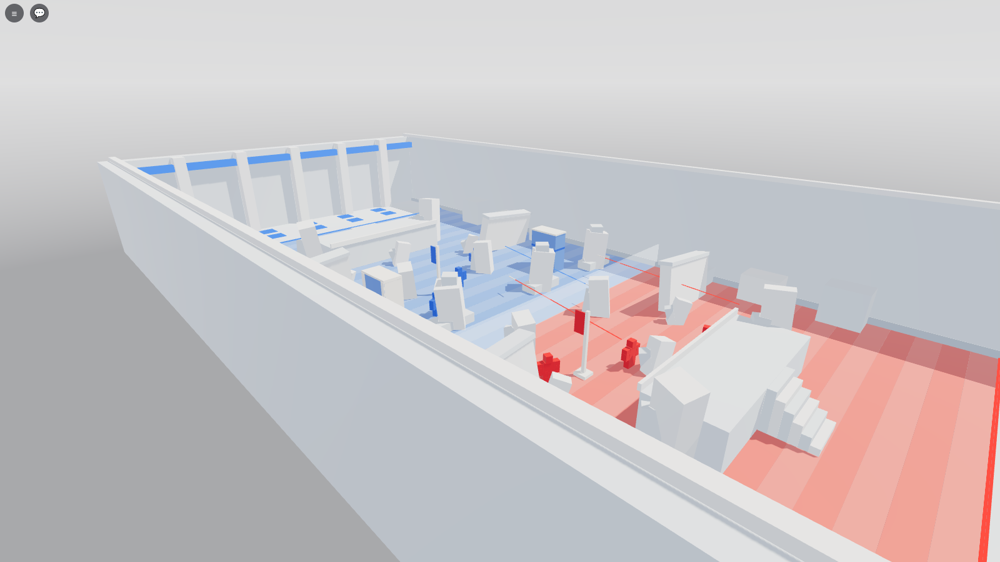
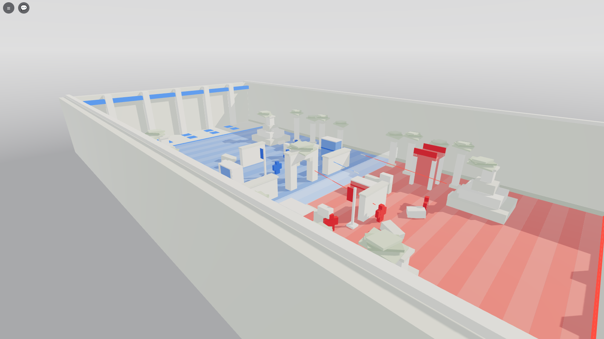
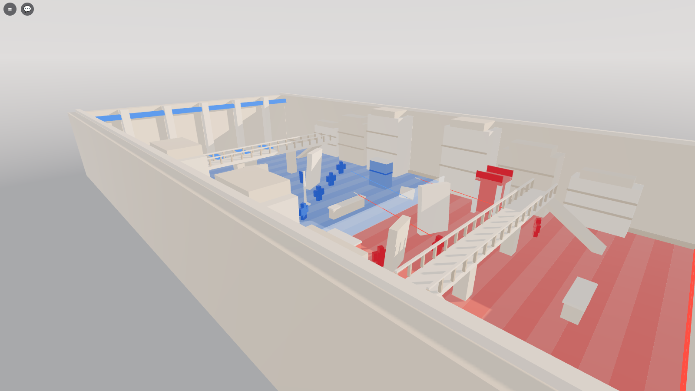

# ra9 · Turf Wars: Overdrive

A fast first-person team-warfare game after Mineplex Turf Wars, in the look of SUPERHOT: a plain white geometric
world where the only colours are the teams, red and blue. Two teams build defences, then fight with bows; every
kill pushes the frontline toward the enemy's base until one team runs out of turf. Up to 40 players, no lobby, the
next map loads in the same server.

* Game: `games/ra9 - Turf Wars Overdrive/` (Rojo project, `TurfWarsOverdrive.rbxl` built from it)
* [The master plan](MASTER_PLAN.md) (the design brief, the art direction and the decisions) ·
  [the build plan and what was built](PLAN.md)
* [Map renders](screenshots/) (from the mock engine through `tools/gameplay`)

## The maps

| Castle Clash | Frostbite |
|---|---|
|  |  |
| **Jungle Rush** | **Dust Devil** |
|  |  |

## Running the tests

`sh tools/run_tests.sh` from the game folder (needs Rust once, to build the Luau runner): the rules and every map
(fair, closed, open lanes), a whole match from the server's side, and the same through the real client.

## Publishing checklist (once a place exists)

1. Create the experience on Roblox, publish `TurfWarsOverdrive.rbxl` (or `rojo serve` the project).
2. Server Size 40. Allow HTTP Requests (for the Discord log and analytics, once they're in: PLAN.md, phase F).
3. Record the place and universe ids here.
