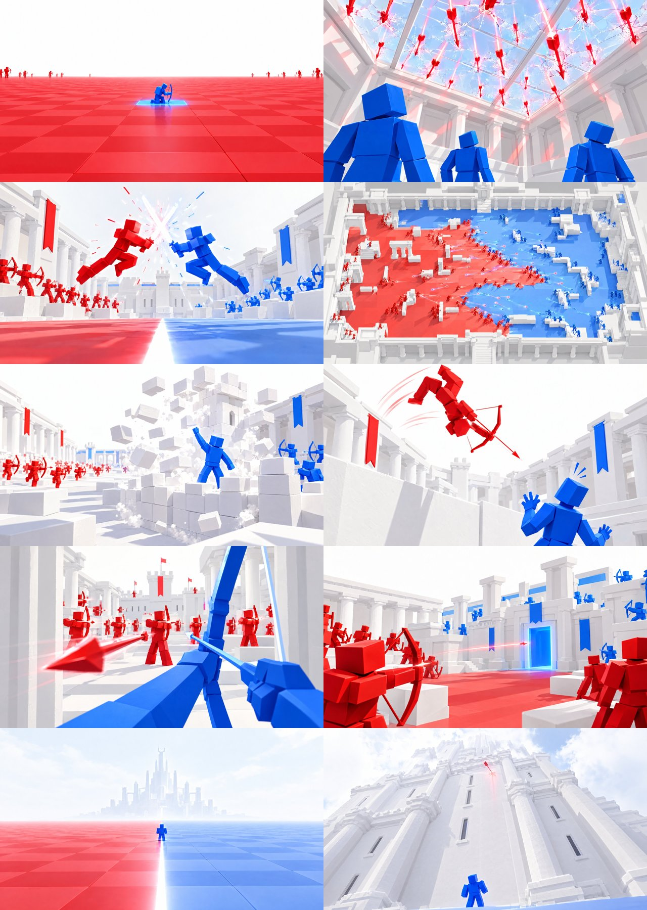

# Turf Wars: ad images (no text)

For **Roblox Ads Manager** (sponsored experience ads). Each is **1920 × 1080 (16:9), JPG, under 0.3 MB**; a
campaign takes up to 10. **No words at all**: Roblox prints the game's name and "Sponsored" beside every ad.

**The idea: one frozen, striking moment.** A feed is full of loud, busy thumbnails; these are almost all white, with
a single hit of red and blue and the long glowing tracer lines of arrows, so they stop the scroll by being calm and
strange. Each one shows something real from the game, caught at its most dramatic.

Made with AI image generation (Higgsfield, GPT Image 2.5, high, 2k) using **real renders of the game** as references
(`../screenshots/`: the four maps, the first-person bow, the victory).

| # | File | Picture | In the game |
|---|---|---|---|
| 1 | `01_frozen_volley.jpg` | A red archer leaps through the air, bow drawn, a volley of blue arrows frozen around them | Arrows with team tracers, Castle Clash |
| 2 | `02_the_line_from_above.jpg` | The courtyard from above, split exactly into red and blue turf, armies at the line | The turf and the frontline |
| 3 | `03_full_draw.jpg` | First person: blue arms at full draw, a red archer on a white tower far ahead | The first-person bow, towers |
| 4 | `04_ice_slide.jpg` | A blue archer slides across a glacier while red arrows streak overhead | Frostbite, the slide |
| 5 | `05_canyon_long_shot.jpg` | Two tiny archers on mesas, one red tracer arcing across the canyon | Dust Devil's long sightlines |
| 6 | `06_close_call.jpg` | A blue archer behind a pillar, a red arrow just landed beside their head | Jungle Rush's cover and narrow routes |
| 7 | `07_build_under_fire.jpg` | The red team racing to build a fort as blue arrows rain in | Building, then the fight |
| 8 | `08_red_wins.jpg` | Red fireworks over the red team; the blue banner falls | The win and its fireworks |

Some details are made up for the picture: the frozen mid-air arrows (they fly in the game), the ice spray, and the
arrows rain thicker than any one moment in play.
