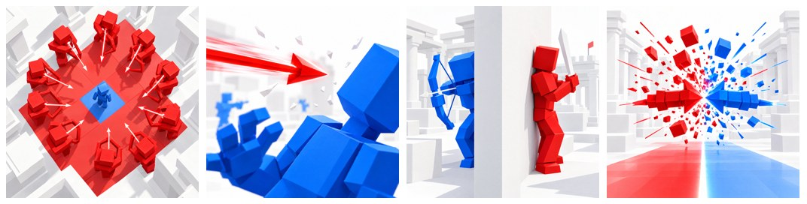

# Turf Wars: the icon

**512 × 512 PNG, no text.** Each one asks a question the player wants answered, so it gets the click.

| File | Picture | The question |
|---|---|---|
| `icon_main.png` (use this) | From above: one blue player on the last blue tile, a ring of red archers closing in | Can he get out? |
| `icon_close_call.png` | A red arrow frozen an inch from a blue player's head | Did it hit? |
| `icon_behind_the_wall.png` | A blue archer peeks round a wall; a red one waits on the other side with a blade | Who wins? |
| `icon_clash.png` | A red and a blue arrow smash together over the line, red floor and blue floor | Which side wins? |

Run the alternates in Roblox's icon test against the main one and keep the winner. Made with Higgsfield (GPT Image
2.5, high, 2k) using the game's art and renders as references, cut to 512 × 512 with `title_art.py --icon`.
